# Using Aspera API for Integration and Automation
<!-- gfm2pdf
common:
  metadata:
    subtitle: "Unofficial document"
    author: "Laurent MARTIN"
-->
<!-- markdownlint-disable MD033 MD060 -->

## Introduction

This document examines the various methods for integrating
with IBM Aspera APIs to harness their high-performance file transfer capabilities.

IBM Aspera data transfer technology is delivered through a suite of products,
each comprising components that expose APIs for integration.

Ultimately, most integrations aim to leverage the IBM Aspera FASP protocol to achieve maximum transfer speeds.

All Aspera transfers involve a client connecting to a server to either push or pull files.
The client component is either one of Aspera's client applications, a server,
or a custom application built using Aspera's client libraries.
The server component is always the IBM Aspera High-Speed Transfer Server (HSTS) or Endpoint (HSTE),
or the SaaS version: Aspera Transfer Service (ATS).

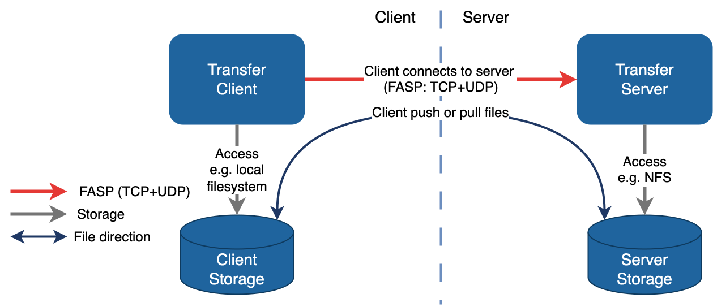

### Components and their APIs

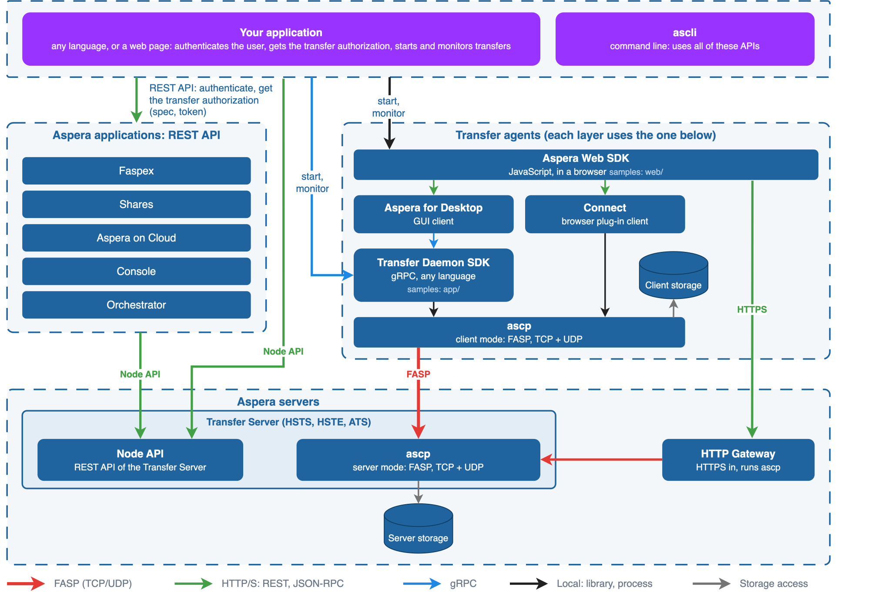

These three types of software components provide APIs:

- **Transfer Server (HSTS)**: Node API (REST)
  - Monitor and manage transfers (`GET /ops/transfers`)
  - Start server-to-server transfer (as "transfer client" to remote server) (`POST /ops/transfers`)
  - Get authorization for transfer (typically for web) (`POST /files/*_setup`)
  - Basic file system operations (list files, create folder, etc.) (`GET`/`POST /files/...`)
  - Supports "watch folder" (includes growing file transfer) (`/watchfolders/`...), `async`, stream, etc.
  - Also provides the server side for FASP transfer (UDP, `ascp`)
- **Applications**: Faspex, Shares, AoC, Console, Orchestrator API (REST)
  - Provide REST API
  - Do not embed the FASP protocol, but the web app uses the Node API of Transfer Servers
  - Can control and use several Transfer Servers
  - Applications authenticate users, manage users, manage file resources, authorize users for transfers
- **Transfer Agents**: software that starts and monitors transfer sessions, through an SDK
  - Transfer Daemon SDK: the Transfer Daemon (`transferd`) provides a **gRPC** interface
    that can be used from virtually any language.
    It provides transfer session management (start, monitor),
    and internally starts one `ascp` process per transfer session.
  - Web SDK: provides the equivalent of the Transfer Daemon SDK API in the browser (JavaScript),
    with Aspera for Desktop, Connect or HTTP Gateway.
    It replaces the former Connect SDK, HTTP Gateway SDK and Desktop SDK.
  - Mobile SDK: the equivalent of the Transfer Daemon SDK for mobile (Swift for iOS, or Java for Android) (under review)
  - Other transfer agents have no SDK: `ascp` (command line options, no transfer spec),
    and the Node API of a server (see above).

> [!NOTE]
> The Aspera legacy client SDK was called "FaspManager" and is now deprecated (do not use).
> It provided language-specific implementations: C/C++, Java, Go, Python, .NET, C# (, Ruby).
> FaspManager2 (based on SWIG) is also deprecated.

### API definitions

Official definitions are published on the [Aspera API Hub].
This repository also maintains a copy of the OpenAPI specifications in the folder [openapi](../openapi),
and a viewer (Swagger-like, searchable) here: <https://ibm.biz/aspera_openapi>.

For each API there are up to two kinds of files:

- The original file, as published by IBM (or the closest available).
- The `-enhanced` file: corrected and completed by this repository, and checked with the IBM `openapi-validator`
  (`npm run lint` in the folder `openapi`). Prefer it, and prefer it when generating a client or code with an AI agent.

| API | Files in this repository |
|---|---|
| Node API (HSTS, HSTE, ATS) | [4.4.6](../openapi/IBM%20Aspera%20Node%20API-4.4.6.yaml), [4.4.1](../openapi/IBM%20Aspera%20Node%20API-4.4.1.yaml) |
| Faspex | [5.0 enhanced](../openapi/IBM%20Aspera%20Faspex%20API-5.0-enhanced.yaml), [5.0](../openapi/IBM%20Aspera%20Faspex%20API-5.0.json) |
| Aspera on Cloud | [0.2.6 enhanced](../openapi/IBM%20Aspera%20on%20Cloud%20API-0.2.6-enhanced.yaml), [0.2.6](../openapi/IBM%20Aspera%20on%20Cloud%20API-0.2.6.yaml) |
| Aspera on Cloud Automation | [1.0.5 enhanced](../openapi/IBM%20Aspera%20on%20Cloud%20Automation%20API-1.0.5-enhanced.yaml), [1.0.5](../openapi/IBM%20Aspera%20on%20Cloud%20Automation%20API-1.0.5.yaml) |
| Shares | [Shares](../openapi/IBM_Aspera_Shares.yaml) |
| Orchestrator | [v1 enhanced](../openapi/IBM%20Aspera%20Orchestrator%20API-v1-enhanced.yaml), [v1](../openapi/IBM%20Aspera%20Orchestrator%20API-v1.yaml) |
| Console | [enhanced](../openapi/IBM%20Aspera%20Console-enhanced.yaml) |
| faspio Gateway | [1.0.0 enhanced](../openapi/IBM%20Aspera%20faspio%20Gateway%20API-1.0.0-enhanced.yaml), [1.0.0](../openapi/IBM%20Aspera%20faspio%20Gateway%20API-1.0.0.yaml) |
| Transfer Daemon configuration | JSON Schema [transferd-config.schema.json](../openapi/transferd-config.schema.json) |

The gRPC definition of the Transfer Daemon, `transferd.proto`, is not in this repository:
it is in the Transfer Daemon SDK archive (see [Transfer agents and tools](#transfer-agents-and-tools)).
The Web SDK is documented in its [TypeDoc](https://ibm.github.io/aspera-sdk-js/docs/).

The guide explains concepts and flows.
The reference of a REST call (parameters, schemas, errors) is in these definitions: use them rather than the guide.

### Choose your integration

Find the row that matches what you want to build.
Each row gives the client, the authorization, the guide section to read and the samples of this repository
(the samples exist in several languages: see [Available samples](../README.md#available-samples)).

| I want to... | Transfer agent | Authorization | Read | Sample |
|---|---|---|---|---|
| Send or receive files from a script, with an account on a server I own | `ascp` or `ascli` | SSH | [S1](#s1--the-simplest-integration-start-a-transfer-with-a-script-and-ascp) | |
| Transfer from my own desktop or server application (any language), with an account on a server I own | Transfer Daemon (gRPC) | SSH | [S2](#s2--start-a-transfer-with-transfer-daemon-sdk-and-listen-for-events) | `minimal`, `server` |
| Let users of my web application transfer from their browser | Web SDK | Token, generated by my back end | [S3](#s3--start-a-transfer-in-a-web-browser), [A2](#a2--aspera-transfer-token-authorization) | `web/` |
| Authenticate my own users and decide what they can transfer, from a custom application | Transfer Daemon, or Web SDK | Transfer token (ATx), generated by my back end | [S5](#s5--start-a-transfer-with-token-authorization), [A2](#a2--aspera-transfer-token-authorization) | `node`, `node_v2` |
| Transfer between two servers I own, with SSH accounts | Node API on the source server | SSH | [S4](#s4--start-a-server-server-transfer-with-node-api-and-ssh-credentials) | |
| Transfer between two servers I own, without SSH accounts | Node API on the source server | Transfer token | [S6](#s6--start-a-server-server-transfer-with-node-api-and-transfer-token) | `node_v2` |
| Follow or list the transfers of a server | Node API | Node user or access key | [S7](#s7--polling-on-transfer-status-on-node-api) | |
| Send or receive a package with Faspex | Transfer Daemon, or Web SDK | Faspex OAuth bearer token, gives a transfer spec with token | [Faspex](#faspex) | `faspex5` |
| Send or receive a package or files with Aspera on Cloud | Transfer Daemon, or Web SDK | AoC OAuth bearer token, then node bearer token | [Aspera on Cloud](#ibm-aspera-on-cloud), [A3](#a3--aspera-bearer-token-authorization) | `aoc` |
| Use Aspera Shares | Transfer Daemon | Same as Node API | [Shares](#ibm-aspera-shares) | `shares` |
| Use IBM Cloud Object Storage | Transfer Daemon | COS credentials | [README](../README.md#cos-service-credentials) | `cos` |

If the table does not settle it, answer these questions in order:

1. **Do you already have an Aspera application** (Faspex, AoC, Shares)?
   Yes: use its REST API to get the transfer spec, never generate tokens yourself.
2. **Does the transfer start in a web browser?**
   Yes: use the Web SDK, and a token (SSH credentials must not reach the browser).
3. **Do you have your own users to authenticate?**
   Yes: use a token, see [Choosing the Right Token Type](#choosing-the-right-token-type).
   No, only a server account: use SSH credentials.
4. **Is the client a server?** Yes: use the Node API (`POST /ops/transfers`), else use the Transfer Daemon.

### Where to start

There are many scenarios to use Aspera to send files.
A typical path:

1. Get familiar with what an Aspera transfer is: see [Concepts](#concepts).
2. Get the `ascp` executable and the free license file, from the Transfer Daemon SDK or one of the free clients:
   see [Transfer agents and tools](#transfer-agents-and-tools).
3. Execute command line transfers with `ascp` or `ascli` to a test server using SSH credentials:
   see [S1](#s1--the-simplest-integration-start-a-transfer-with-a-script-and-ascp).
4. Do the same with the client method chosen, for example `transferd` with gRPC:
   see [S2](#s2--start-a-transfer-with-transfer-daemon-sdk-and-listen-for-events), and the samples of this repository.
5. If you send to an Aspera application (Faspex, AoC),
   use its REST API to create a **transfer spec** (with token authorization): see [Aspera applications](#aspera-applications).
6. If you need to receive files on your own Aspera server,
   install an Aspera Transfer Server to test with (evaluation or development license),
   and initiate transfers to it using the chosen methods (Web SDK, Node API, etc.).

If something fails, see [Troubleshooting](#troubleshooting).

In order to test, one needs:

- Client-side libraries (Transfer Daemon SDK, Web SDK, Mobile SDK) or API definitions (Node API, web app API)
- Server-side testing server

### Addresses and Credentials

Examples provided in this document use the following virtual connection information:

- `hsts1.example.com`: Address of HSTS 1.
- `<HSTS1_XFER_USER>`: A transfer user with SSH credentials on HSTS 1.
- `<HSTS1_XFER_PASSWORD>`: Password for `<HSTS1_XFER_USER>`.
- `<HSTS1_NODE_USER>`: A Node API user (or access key ID).
- `<HSTS1_NODE_PASSWORD>`: Password for `<HSTS1_NODE_USER>` (or access key secret).
- `hsts2.example.com`: Address of HSTS 2.
- `<HSTS2_NODE_USER>`: A Node API user (or access key ID).
- `<HSTS2_NODE_PASSWORD>`: Password for `<HSTS2_NODE_USER>` (or access key secret).

## Concepts

When using Aspera to transfer data between two storage systems, a few fundamental concepts always apply.
These concepts are independent of the specific API, SDK, or product being used
(`ascp`, `ascli`, `transferd`, **Node API**, server REST API, etc.).

### Base rules for a transfer

100% of transfers using Aspera consist of:

- An `ascp` process started in client mode, connecting to a transfer server (SSH or WSS).
- Upon successful connection, an `ascp` process in server mode is started and listens on UDP.
- The connection is direct between client and server using the IP protocol
  (there can be Aspera proxies in the middle (reverse, forward)),
  with one TCP connection per transfer session (`ascp` process), and one UDP session.
- Some sort of authorization is required (either just SSH credentials, or a transfer token).
- If the client sends the files, then it is an upload. If the client receives the files, it is a download.
- In all cases, a transfer session is initialized using a "transfer specification", a JSON structure
  (except direct execution of `ascp` which uses command line options).

### Client and server roles

An Aspera transfer always involves two distinct roles:

- Client: the side that initiates the transfer.

- Server: the side that accepts the transfer.

The client may either send data to the server (upload) or retrieve data from it (download),
but the direction of the data flow does not change the roles: the initiator is always the client.

### Server-side storage access (docroot / storage root)

The server side is always configured with access to a storage backend.

This is done through:

- a docroot, or

- an access key + storage root (conceptually equivalent).

The server is responsible for accessing the underlying storage, which can be:

- local filesystem storage, or

- supported object storage (via **PVCL**, such as S3-compatible storage, cloud object stores, etc.).

To do this, the server must be provided with appropriate credentials, which depend on the storage type:

- filesystem permissions for local storage,

- cloud/object-storage credentials for object storage.

Without this configuration, a server cannot read or write data, regardless of the client.

### Client types and storage capabilities

The client side can take different forms:

- Simple transfer clients

  Examples: `ascp`, `ascli`, `transferd`, Aspera for Desktop, custom SDK-based clients.

  These clients only support local filesystem storage.

  They do not define a docroot or storage root.

  Files are always read from or written to the local machine where the client runs.

- Servers acting as clients

  An Aspera server can also act as a client.

  In that case:

  - The server-as-client is configured exactly like a server:

    - it defines a docroot (or storage root),

    - it may access object storage,

    - it requires storage credentials.

  - Credentials for object storage are provided either:

    - directly in the docroot URL, or

    - via the access key configuration.

  This allows transfers between two non-local storage systems, such as object storage to object storage.

### Remote control of clients

A client does not need to be manually started by a user.
Clients can be remotely controlled:

- A simple client (e.g. `ascli`) can be started remotely via SSH.

- `transferd` exposes a gRPC API that allows remote control of transfers.

- An Aspera server acting as a client can be remotely controlled using its REST API:

  - for example, `POST /ops/transfers` to initiate a transfer.

  - access to this API itself requires proper authentication.

In all cases, the entity triggering the transfer is still the client, even if it is controlled remotely.

### Transfer authorization

To initiate a transfer, the client must be authorized to access the server.

This authorization can take different forms, depending on the environment and API:

- SSH-based credentials (user/password or key):
  the legacy mode, used for example with Desktop Client or server-to-server transfers,

- transfer tokens (Aspera transfer token, JWT, or similar mechanisms):
  used for example when a web application manages users.

Without valid authorization, a transfer cannot be started, even if both client and server are correctly configured.

Details, and how to choose a token type: see [Transfer authentication and authorization](#transfer-authentication-and-authorization).

### Transfer specification

Besides authorization, other parameters are required when starting a transfer, such as transfer direction,
while others are optional, such as target speed.

This document will show session parameters using the standardized JSON format "transfer specification"
and refer to session parameters as **transfer spec**.
Use of transfer spec is pervasive in Aspera to describe and start a transfer session:
this is the native format used in Web SDKs, `transferd`, Node API and `ascli`.
Only `ascp` does not support transfer spec (yet), and uses regular command line options.

Example of a simple transfer spec for a download using SSH credentials (without token):

```json
{
    "remote_host"     :"hsts1.example.com",
    "ssh_port"        :33001,
    "remote_user"     :"<HSTS1_XFER_USER>",
    "remote_password" :"<HSTS1_XFER_PASSWORD>",
    "direction"       :"receive",
    "destination_root":".",
    "paths":[
        {"source":"/aspera-test-dir-tiny/200KB.1"}
    ]
}
```

An example with transfer authorization token is provided in [Token generation](#token-generation).

90% of transfer spec parameters are identical between the various APIs (Node API, `transferd`, Web SDK, ...).

Parameters can be found in the various API definitions, or with the CLI:

```shell
ascli conf ascp spec
```

#### Transfer spec version 2

The format above is transfer spec version 1, supported by all APIs.
The Transfer Daemon (`transferd`) also accepts transfer spec version 2,
a structured format where parameters are grouped in modules:

| Module               | Content |
|--------------------|--------------------------------------------------------------------|
| `session_initiation` | How the session is initiated and authorized: `ssh`, `node_api` or `icos` |
| `assets`             | Source and destination: `destination_root`, `paths`, ... |
| `security`           | Security parameters, e.g. `cipher` |
| `transport`          | Rate policy, target rate, ports, ... |
| `file_system`        | Handling of files and directories being transferred |
| `tracking`           | Asset tracking, e.g. tags |

Other parameters are at the top level: `direction`, `remote_host` and `title`.

With `node_api` (Node API URL and credentials) or `icos` (IBM Cloud Object Storage credentials),
`transferd` gets the transfer authorization itself:
the application does not need to call `/files/*_setup` first.

Example of upload with Node API credentials (sample `node_v2`):

```json
{
  "title": "send using Node API and ts v2",
  "direction": "send",
  "session_initiation": {
    "node_api": {
      "url": "https://hsts1.example.com:9092",
      "headers": [
        {"key": "Authorization", "value": "Basic <base64 of <HSTS1_NODE_USER>:<HSTS1_NODE_PASSWORD>>"}
      ]
    }
  },
  "assets": {
    "destination_root": "/Upload",
    "paths": [{"source": "file.txt"}]
  }
}
```

In this repository, samples with suffix `_v2` use transfer spec version 2.
The reference of transfer spec version 2 is provided in the Transfer Daemon SDK: `api/transferd.md` (`TransferSpecV2`).

## Transfer agents and tools

### `ascp`

`ascp` is the executable that actually transfers files: all Aspera transfers use it
(see [Base rules for a transfer](#base-rules-for-a-transfer)).

#### Client-side minimum components

On the client side, the minimum setup for a FASP transfer consists of two files:

- `ascp` (executable)
- `aspera-license` (free license file, in the same folder as `ascp`, or in `../etc`)

Those files can be found in the [`transferd` archive](https://developer.ibm.com/apis/catalog?search=%22aspera+transfer+sdk%22).

They can also be found in free clients.

#### First `ascp` invocation

Test `ascp` with a few useful options:

```shell
ascp -A
```

```console
IBM TransferD version 1.1.9
ascp version 4.4.8.2592 6a5e6bf
Operating System: MacOSX
License max rate=(unlimited), account no.=1, license no.=56
Enabled settings: stream and sync2
```

```shell
ascp -h
```

```shell
ascp -hh
```

```shell
ascp -DDA
```

```shell
ascp -DDL-
```

#### Sample optional config file for client `ascp`

On the client side, it is optionally possible to create a configuration file: `aspera.conf`
(in the same folder as `ascp`, or in `../etc`).

Example of configuration file: `aspera.conf`, on client side (optional):

```xml
<?xml version='1.0' encoding='UTF-8'?>
<CONF version="2">
<default>
    <file_system>
        <resume_suffix>.aspera-ckpt</resume_suffix>
        <partial_file_suffix>.partial</partial_file_suffix>
        <replace_illegal_chars>_</replace_illegal_chars>
    </file_system>
</default>
</CONF>
```

Smallest configuration file:

```xml
<CONF/>
```

> [!NOTE]
> This file is mandatory on the server side.
> On Transfer servers, this file is easily modified with the command `asconfigurator`,
> which is not available in client applications and SDKs.

### Transfer Daemon: `transferd`

The Transfer Daemon, `transferd`, provides a **gRPC** API to start and follow transfers.
For each transfer session, it starts an `ascp` process and collects its progress.
A client application calls this API from any language that has gRPC.

The Transfer Daemon SDK ([Transfer Daemon SDK], or `make sdk` in this repository) contains:

- `sbin/transferd`, and the FASP runtime: `bin/ascp`, `etc/aspera-license`, `etc/aspera.conf`
- `etc/transferd.json`: the configuration file of `transferd`
- `api/transferd.proto`: the gRPC definition, and `api/transferd.md`: its reference (messages, calls, statuses, events)
- `api/<language>`: examples, and the code generated from `transferd.proto` (or how to generate it)

#### Starting up

The daemon must run before a client connects to it.
It's up to the developer to decide how to start the daemon:

- For quick development: manually, in a separate terminal.
- For server-level applications: as a system service (`systemd`).
- For end-user applications: as a background process, started by the main process (as in the sample `minimal`).

Without option, `transferd` reads the configuration file `etc/transferd.json` of the SDK.
Its main keys:

| Key | Use | Value in the SDK |
|---|---|---|
| `address`, `port` | Address and port where the gRPC API listens | `127.0.0.1`, `55002` |
| `fasp_runtime.use_embedded` | Use the FASP runtime of the SDK (`ascp`, license, `aspera.conf`) | `true` |
| `fasp_management.port` | Port where the `ascp` processes report their progress to `transferd` | `23456` |
| `workers.max_concurrent` | Maximum number of transfers at the same time: the others are queued | `10` |

The JSON Schema [transferd-config.schema.json](../openapi/transferd-config.schema.json) describes all keys,
and the SDK has a sample with more keys: `etc/transferd-sample.json`.
To listen on an address other than loopback, consider enabling `tls` and `authentication` in the configuration.

The sample `minimal` stops the daemon with the signal `SIGINT` (on Windows: terminate the process).

#### gRPC API

The service `TransferService` has these main calls:

| Call | Use |
|---|---|
| `StartTransferWithMonitor` | Start a transfer and receive the stream of its events, until the transfer is terminated |
| `StartTransfer` | Start a transfer: returns its transfer ID (`transferId`) |
| `MonitorTransfers` | Receive a stream of events of the transfers that match filters (for example a transfer ID), until the client cancels it |
| `QueryTransfer` | Get the status and statistics of a transfer, once |
| `StopTransfer` | Stop transfers, given their IDs |
| `GetInfo`, `GetAPIVersion` | Get information on the daemon, and the version of the API |

To start a transfer and follow it, use `StartTransferWithMonitor`, as the sample `minimal` does.
The same call starts the transfer and streams its events, until the transfer is terminated.
With `StartTransfer` then `MonitorTransfers`, the transfer can end before the call to `MonitorTransfers`.
The stream of `MonitorTransfers` only ends when the client cancels it: the application can then wait forever.

`StartTransfer` then `MonitorTransfers` is still useful:

- When the application needs the transfer ID right after the start: persistent session or stream transfer.
- To follow several transfers with one stream (filters of `MonitorTransfers`).

The request of `StartTransferWithMonitor` and `StartTransfer` (`TransferRequest`) has three fields:

- `transferType`: `FILE_REGULAR` for the files of the transfer spec (other types: persistent session, streams, `async`).
- `transferSpec`: the [transfer spec](#transfer-specification), as a JSON string.
- `config` (`TransferConfig`): optional settings, such as the retry strategy and the logs of `ascp`.

Each event (`TransferResponse`) has the transfer ID, the status (`status`) and the event type (`transferEvent`).
Event types are, for example, `SESSION_START`, `PROGRESS`, `FILE_STOP` and `SESSION_STOP`.
The event also has statistics (`transferInfo`): bytes transferred, rate, error description.

The main statuses (`TransferStatus`) of a transfer:

| Status | Meaning |
|---|---|
| `QUEUED` | Waiting to start |
| `RUNNING` | In progress |
| `COMPLETED` | Successfully completed |
| `FAILED` | Failed: the cause is in `error`, or else in `transferInfo.errorDescription` |
| `CANCELED` | Canceled by the user |
| `PAUSED` | Paused by the user |
| `UNKNOWN_STATUS` | Unknown: the samples treat it as an error |

Other calls are for persistent sessions (`AddTransferPaths`, `LockPersistentTransfer`),
streams (`ReadStream`, `WriteStream`) and checks (`Validate`, `IsPeerReachable`):
refer to `api/transferd.md` in the SDK.

The flow of a transfer is described in [S2](#s2--start-a-transfer-with-transfer-daemon-sdk-and-listen-for-events).
Examples in several languages are in the SDK (`api/<language>`) and in the folder [app](../app) of this repository:
start with the sample `minimal`.

### Web SDK

Transfers started in a web browser use the Aspera Web SDK (JavaScript): see [S3](#s3--start-a-transfer-in-a-web-browser).

Reference and sample code: [Aspera API Hub] &rarr; IBM Aspera JavaScript SDK.

A sample web application is provided in the folder `web` of this repository.

### Mobile: Android, iOS

The Mobile SDK is the equivalent of the Transfer Daemon SDK for mobile apps (Swift for iOS, Java for Android).
It is currently under review.

### CLI: `ascli`

To test most Aspera APIs and transfer authorization types, one can use the open-source tool `ascli`.

See [manual for installation](https://github.com/IBM/aspera-cli).

`ascli`:

- Connects to all types of Aspera servers
- Provides a logging capability that traces API calls
- Starts transfers using either:
  - Transfer Daemon SDK
  - `ascp`
  - Node API
  - Web client (Connect, Aspera for Desktop)
  - HTTP Gateway

Examples in this document are illustrated with `ascli`.
The developer can monitor internal API calls, as well as the generated transfer spec, using option `--log-level=trace2`.

## Integration Scenarios

This section exhibits various file transfer scenarios.

It shows how a FASP transfer is started using a transfer specification.

The transfer is started using various transfer agent types/SDKs (CLI, web, app, server).

The transfer specification may contain transfer authorization using either
(see [Transfer authentication and authorization](#transfer-authentication-and-authorization)):

- SSH credentials
- Authorization token

Any client type and SDK can be used with any type of transfer authorization: they are independent,
except that HTTP Gateway and WebSocket sessions require token authorization (see [A1](#a1--ssh-authentication)).

Scenarios contain a typical mix of client SDK and transfer authorization type.

The following table summarizes the scenarios,
and the samples of [this repository](https://github.com/laurent-martin/aspera-api-examples) that implement them
(names of the Python samples: refer to the `README.md` of the repository for other languages):

| Scenario | Client | API | Authorization | Samples |
|------------------------------------|---------------------------|------------------------|---------------|------------------------|
| [S1](#s1--the-simplest-integration-start-a-transfer-with-a-script-and-ascp): script and `ascp` | Script | Command line | SSH | |
| [S2](#s2--start-a-transfer-with-transfer-daemon-sdk-and-listen-for-events): application with Transfer Daemon SDK | Custom client application | Transfer Daemon gRPC | SSH | `minimal`, `server`, `server_v2` (JS) |
| [S3](#s3--start-a-transfer-in-a-web-browser): web browser | Web browser | Web SDK | Token | `web` |
| [S4](#s4--start-a-server-server-transfer-with-node-api-and-ssh-credentials): server to server, SSH | Transfer Server | Node API | SSH | |
| [S5](#s5--start-a-transfer-with-token-authorization): client and server applications | Custom client application | Transfer Daemon SDK, Node API | Token | `node`, `node_v2`, `shares` |
| [S6](#s6--start-a-server-server-transfer-with-node-api-and-transfer-token): server to server, token | Transfer Server | Node API | Token | |
| [S7](#s7--polling-on-transfer-status-on-node-api): transfer status | | Node API | | |

Other samples use the APIs of Aspera applications (`faspex5`, `aoc`): see [Aspera applications](#aspera-applications).

### S1- The simplest integration: start a transfer with a script and `ascp`

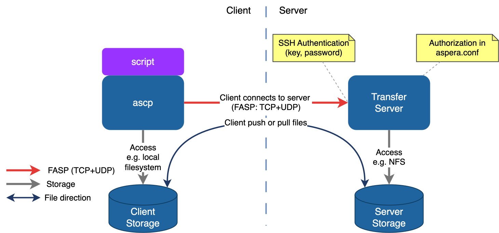

Scenarios:

- I need to replace `scp` or `sftp` in a script and use my existing SSH credentials (password or key)
- I am provided with bare Aspera Transfer credentials, and I need to transfer to that server using my scripts.

| Client | API          | Authorization|
|--------|--------------|---------------|
| script | command line | SSH          |

The simplest and lowest-level integration consists of starting an Aspera transfer as a transfer client
with a Transfer Server (upload or download).
Ultimately, this consists of starting the `ascp` executable in client mode, locally.
Credentials required: SSH credentials provided by the admin of the HSTS server.
This can be done easily in a script.
For example, using bash:

```shell
#!/bin/bash
ASPERA_SCP_PASS=<HSTS1_XFER_PASSWORD> ascp --mode=recv --host=hsts1.example.com -P 33001 \
  --user=<HSTS1_XFER_USER> aspera-test-dir-tiny/200KB.1 .
```

This starts the `ascp` executable with session parameters on the command line (and an environment variable for the password).
`ascp` comes with many session options: a manual can be found in `man ascp` or here: [HSTS Doc] &rarr; ascp command reference.
This is suitable for a simple script-based integration, but this solution suffers from the following limitations:

- No easy way to get progress feedback programmatically (progress bar on terminal)
- No automatic retry of failed transfers: the script must implement a loop
- No programmatic API: a process must be spawned with arguments

Equivalent with `ascli`: (includes resume)

```shell
ascli -N server --url=ssh://hsts1.example.com:33001 \
  --username=<HSTS1_XFER_USER> --password=<HSTS1_XFER_PASSWORD> \
  download aspera-test-dir-tiny/200KB.1
```

By default, `ascli` starts `ascp` itself: this is the transfer agent `direct`.
With the additional option `--log-level=debug`, the log shows the agent, the transfer spec and the arguments of `ascp`:

```console
...
DEBG transfer agent is a Aspera::Agent::Direct
DEBG ts(json)Hash=
{
  "remote_host": "hsts1.example.com",
  "remote_user": "<HSTS1_XFER_USER>",
  "ssh_port": 33001,
  "remote_password": "🔑",
  "direction": "receive",
  "create_dir": true,
  "resume_policy": "sparse_csum",
  "destination_root": ".",
  "paths": [
    {
      "source": "aspera-test-dir-tiny/200KB.1"
    }
  ]
}
...
DEBG ascp args: #<struct Aspera::ExecSpec exec=:ascp, env={"ASPERA_SCP_PASS" => "🔑", ...},
  args=["-q", "-d", "--mode", "recv", "--host", "hsts1.example.com", "--user", "<HSTS1_XFER_USER>",
  "-k", "2", "-P", "33001", "--dest64", "--file-list=...", "Lg=="]>
...
```

Passwords and secrets are masked in logs by default.

Equivalent with `asession` (from `aspera-cli` gem), using a transfer spec: (includes progress and resume)

```shell
asession @json:'{"spec":{
  "remote_host":"hsts1.example.com","remote_user":"<HSTS1_XFER_USER>","ssh_port":33001,
  "remote_password":"<HSTS1_XFER_PASSWORD>","direction":"receive","destination_root":".",
  "paths":[{"source":"/aspera-test-dir-tiny/200KB.1"}]}}'
```

### S2- Start a transfer with Transfer Daemon SDK and listen for events

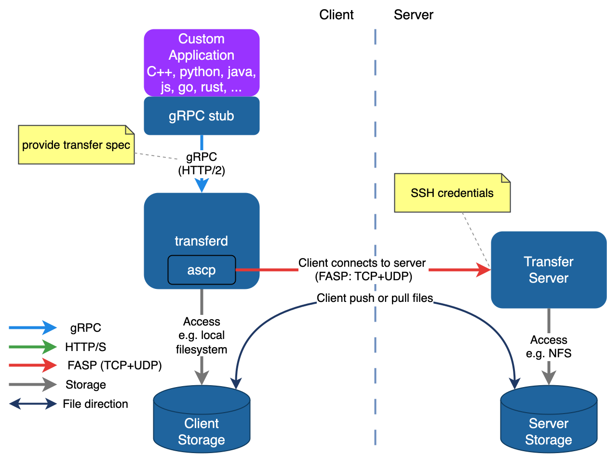

Scenarios:

- I need to transfer files at high speed from my home-grown application to a central place using basic OS credentials
- I am provided with bare Aspera Transfer credentials,
  and I need to transfer to that server using my application written in Java, C++, .NET, Python, etc.

| Client                    | API                  | Authorization|
|---------------------------|----------------------|---------------|
| Custom Client Application | Transfer Daemon gRPC | SSH          |

If the integration to start a simple transfer job is made in an application
written in one of the languages C, C++, C#, Java, Python, Go, Rust, etc.,
then the best option is to use the **Transfer Daemon**: see [Transfer Daemon: `transferd`](#transfer-daemon-transferd).
This component can be freely downloaded here: [Transfer Daemon SDK].
The daemon, `transferd`, provides a gRPC API, and starts `ascp` for each transfer session.
It uses the `ascp` and the license of the SDK (or of another installation: key `fasp_runtime` of its configuration).

The application makes these calls (the sample `minimal` does exactly these steps):

1. Start `transferd`, or use one that runs as a service.
2. Connect to the gRPC API of the daemon: `127.0.0.1:55002` with the configuration file of the SDK.
3. Build the [transfer spec](#transfer-specification): address of the server, SSH credentials, `direction`, `paths`.
4. Call `StartTransferWithMonitor` with the transfer spec (JSON string) and the type `FILE_REGULAR`:
   the daemon starts the transfer, and sends an event on each change, until the end of the transfer.
   Read the events until the status is `COMPLETED` (success), or `FAILED`, `CANCELED` or `UNKNOWN_STATUS` (error).
   The cause of an error is in `error`, or else in `transferInfo`.
5. Stop `transferd`, if the application started it.

To stop a running transfer, call `StopTransfer` with its transfer ID: each event has it (`transferId`).
For the cases where `StartTransfer` then `MonitorTransfers` is still useful, see [gRPC API](#grpc-api).

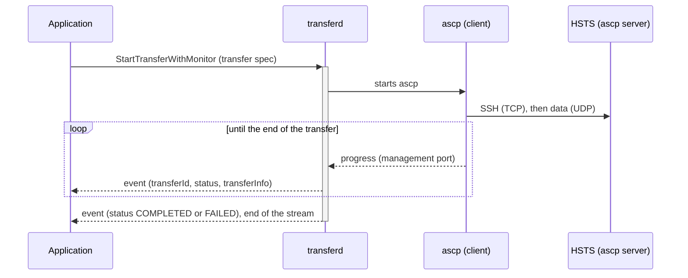

Development of a mobile app is similar, with the Mobile SDK providing a library to start transfers.

Samples of [this repository](../README.md#available-samples):

- `minimal`: the calls above, with the gRPC API only. Read it first.
- `server` and `server_v2` (JS): the same transfer, with the helper class `TransferClient`,
  which also creates the configuration file of `transferd`.

Equivalent with `ascli`, with the transfer agent `transferd` (option `--transfer=transferd`):

```shell
ascli -N server --url=ssh://hsts1.example.com:33001 \
  --username=<HSTS1_XFER_USER> --password=<HSTS1_XFER_PASSWORD> \
  download aspera-test-dir-tiny/200KB.1 --transfer=transferd
```

The transfer spec is the same as in [S1](#s1--the-simplest-integration-start-a-transfer-with-a-script-and-ascp):
only the transfer agent changes, from `direct` to `transferd`.
By default, `ascli` starts a `transferd` for the transfer, and stops it at the end.
This agent requires the Ruby gem `grpc` (`gem install grpc`).

> [!NOTE]
> `ascli` starts transfers with a transfer agent, selected with option `--transfer`:
> `direct` (`ascp`, the default), `transferd`, `node`, `httpgw`, `desktop` or `connect`.
> The command `ascli config agents list` lists them.

### S3- Start a transfer in a web browser

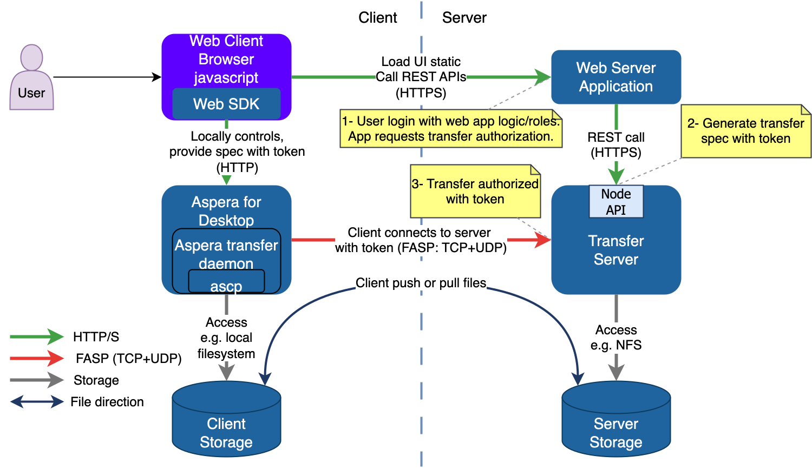

Scenarios:

- I need to transfer files at high speed using a web browser, being authorized by some web application
  (Custom, Faspex, Shares, AoC, ...)

Typically, authentication/authorization is performed in the web app, and a transfer token is used to authorize transfers.

| Client      | API          | Authorization|
|-------------|---------|---------------|
| Web Browser | Web SDK      | Token        |

If the transfer must be started by a user in the context of a web browser,
then the **IBM Aspera JavaScript SDK** can be used (with Aspera for Desktop, Connect or HTTP Gateway).
It consists of a JavaScript library used similarly to the "Transfer Daemon SDK"
(build session parameters, start transfer, monitor progress).

Reference (includes sample code): [Aspera API Hub] &rarr; IBM Aspera JavaScript SDK:
<https://developer.ibm.com/apis/catalog/aspera--ibm-aspera-sdk/Introduction>

The sample [`web`](../web/README.md) of this repository implements this flow.
The browser loads the page and its JavaScript from a server application, and initializes the Web SDK.
When the user starts a transfer, the browser gets a transfer spec from the server application,
which calls `/files/upload_setup` or `/files/download_setup` of the Node API
(see [A2](#a2--aspera-transfer-token-authorization)).
Then the browser calls `startTransfer` of the Web SDK with this transfer spec.

Example using Aspera for Desktop with `ascli` (here, not in a browser):

```shell
ascli -N server --url=ssh://hsts1.example.com:33001 \
  --username=<HSTS1_XFER_USER> --password=<HSTS1_XFER_PASSWORD> \
  download aspera-test-dir-tiny/200KB.1 --transfer=desktop
```

The transfer spec remains identical to the previous `ascli` examples.
Only the transfer agent changes: `desktop` (Aspera for Desktop) instead of `direct` (S1) or `transferd` (S2).
Aspera for Desktop is almost exclusively used in a web context: `ascli` is used here as an example only.

#### Transfers through HTTP Gateway

With HTTP Gateway, the client does not start `ascp`: the HTTP Gateway starts the `ascp` session with the HSTS.
The client is, for example, a browser or `ascli`.
It gets the transfer spec, with a transfer token, from the application (AoC, Faspex or another), as for any transfer.
To download, the client starts the session with `POST /download`, then gets the file with `GET /download/:id`:
if there are several files, the HTTP Gateway sends them in a zip file.
To upload, the client opens a WebSocket, sends the transfer spec, then sends the files over the WebSocket.

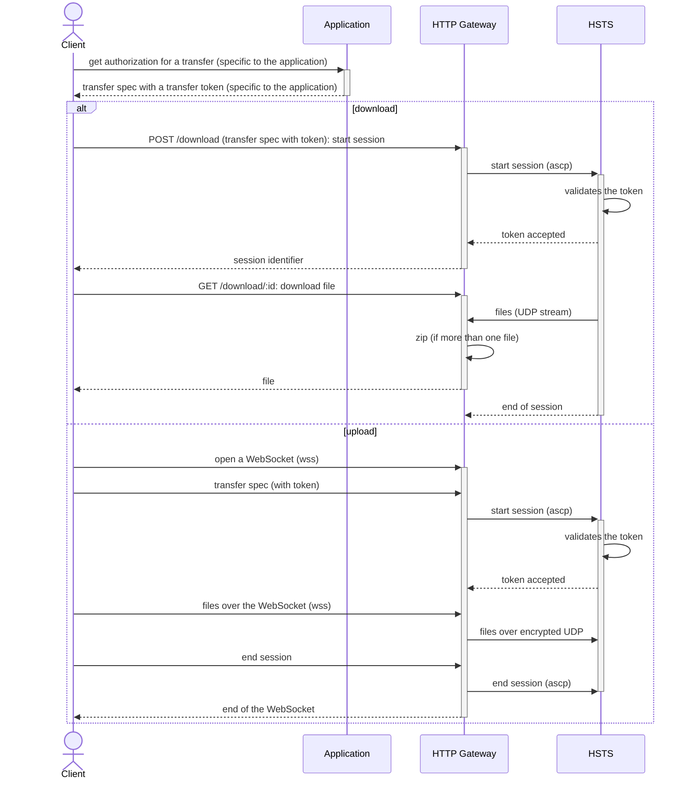

### S4- Start a Server-Server transfer with Node API and SSH credentials

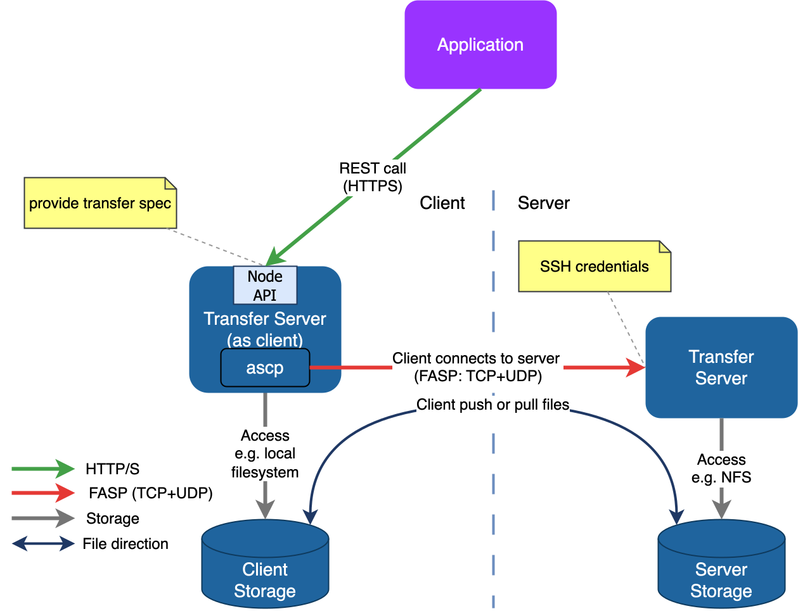

Scenarios:

- I need to transfer files between two servers in an automated manner or using REST APIs.
- I own the system used as client side (an HSTS), but not the remote system for which I have only SSH credentials.

Machine-to-machine transfer.

| Client                    | API                  | Authorization |
|------------------------|----------|---------------|
| Aspera Transfer Server    | Node API             | SSH           |

This is the method used for automated server-to-server transfers.
A transfer can be started remotely (using its REST API) on a server to another remote server.
There are two servers here: one starts the transfer as client, and connects to the other one.
The managing application uses the "Node API" to control the client side of the transfer.
Basically: `POST /ops/transfers` with a JSON payload containing session parameters:
transfer spec with SSH credentials of the remote server.

Equivalent API call, on the client side of the transfer (`hsts2.example.com`):

```shell
curl -s -u <HSTS2_NODE_USER>:<HSTS2_NODE_PASSWORD> \
  https://hsts2.example.com:9092/ops/transfers \
  -H 'Content-Type: application/json' \
  -d '{"remote_host":"hsts1.example.com","ssh_port":33001,
    "remote_user":"<HSTS1_XFER_USER>","remote_password":"<HSTS1_XFER_PASSWORD>",
    "direction":"receive","destination_root":".",
    "paths":[{"source":"aspera-test-dir-tiny/200KB.1"}]}'
```

Example of use with `ascli`: (for demonstration of use of API)

```shell
ascli --url=ssh://hsts1.example.com:33001 \
  --username=<HSTS1_XFER_USER> --password=<HSTS1_XFER_PASSWORD> \
  --transfer=node --transfer-info=@json:'{"url":"https://hsts2.example.com:9092",
    "username":"<HSTS2_NODE_USER>","password":"<HSTS2_NODE_PASSWORD>"}' \
  --log-level=debug server download aspera-test-dir-tiny/200KB.1
```

> [!NOTE]
> Option `--transfer=node` tells `ascli` to start the transfer remotely.

In this example, the remote server `hsts2.example.com` is used (as client) to download from server `hsts1.example.com`.

### S5- Start a transfer with Token Authorization

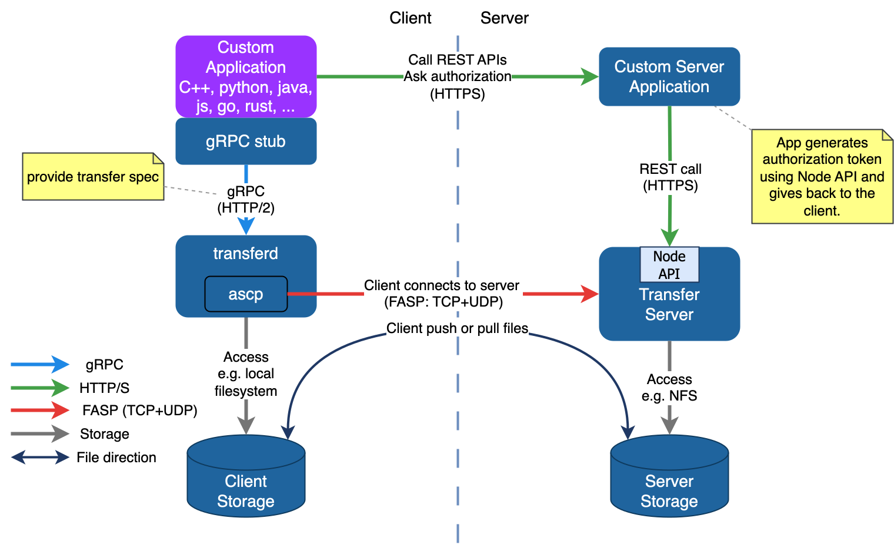

Scenarios:

- I need to transfer files between my custom client app and my custom server app, using my own authentication/authorization.

| Client                    | API                  | Authorization |
|---------------------------|---------------------------|---------------|
| Custom Client Application | Transfer Daemon SDK (client app)<br/>Node API (server app) | Token |

In previous examples, transfers were started using SSH credentials and no token, using various client application types:
command line, Transfer Daemon SDK, browser, server (node) or even mobile.
Using SSH credentials, the authentication and transfer authorization are provided by the bare Aspera Server
and its host operating system.
In fact, in many integration cases,
a custom (e.g. web) application server takes care of user authentication and transfer authorization (e.g. RBAC).
In this case, once the server application has authenticated and authorized a transfer,
it will convey this transfer authorization by generating a "transfer authorization token".
Then, the transfer client provides this token to the Aspera server to get authorized to transfer to it.
Several token types are supported (Aspera transfer token, Basic, Bearer):
see [Choosing the right token type](#choosing-the-right-token-type).
The Aspera transfer token is a simple choice, as no authorization needs to be set up in advance:
the server application generates it on the fly with the Node API,
after it has checked that the application-level user effectively has rights.
Token generation is detailed in [A2](#a2--aspera-transfer-token-authorization).

The client application uses one of the SDKs for transfer:

- Transfer Daemon (gRPC)
- Web (JavaScript)
- Mobile (Swift, Java)
- Node (REST)

### S6- Start a Server-Server transfer with Node API and Transfer token

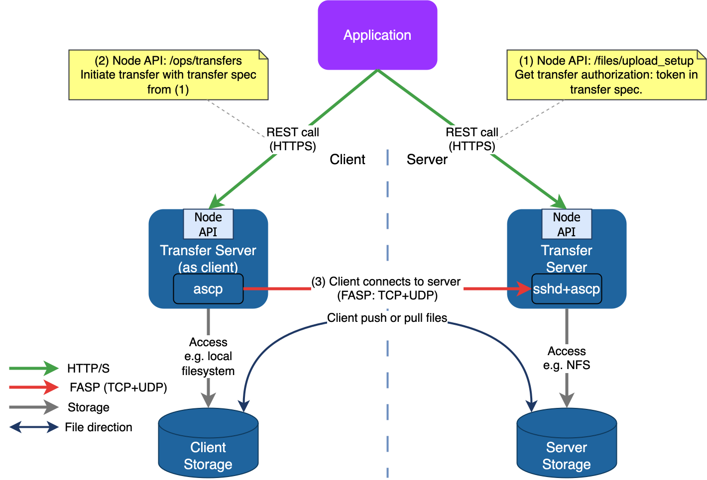

Scenarios:

- I own both systems used for the transfer (both are HSTS),
  and I use the Node API to get transfer authorization on the destination,
  and the Node API to initiate the transfer on the source system.

Machine-to-machine transfer.

| Client                    | API                  | Authorization |
|------------------------|----------|---------------|
| Aspera Transfer Server    | Node API             | Token         |

This is the method used for automated server-to-server transfers if one owns both servers and token-based transfer is preferred.
First the managing application must retrieve a transfer authorization
(as well as transfer details, such as server address) using the Node API on the **server side of the transfer**:
`POST /files/upload_setup` with transfer request, which generates a transfer spec.
Then, the managing application uses the Node API to control the **client side of the transfer**.
Basically: `POST /ops/transfers` with transfer spec generated previously.

A common mistake is to call both APIs on the same server: client side.
Incidentally, this could work if the transfer username is the same on both sides,
and if the `token_encryption_key` is the same on both sides for that transfer user.
But in general, it will fail, either because the transfer user is different,
or the token cannot be decrypted (different encryption key).
So, really, authorization shall first be generated on the server side,
and the transfer shall be initiated on the client side.

Equivalent API calls (the first result is edited with `jq`):

```shell
# 1. server side of the transfer (hsts1): get a transfer spec with an Aspera transfer token
curl -s -u <HSTS1_NODE_USER>:<HSTS1_NODE_PASSWORD> \
  https://hsts1.example.com:9092/files/upload_setup \
  -H 'Content-Type: application/json' \
  -d '{"transfer_requests":[{"transfer_request":{"paths":[{"destination":"/"}]}}]}' \
  | jq '.transfer_specs[0].transfer_spec | .paths = [{"source":"aspera-test-dir-tiny/200KB.1"}]' \
  > transfer_spec.json
# 2. client side of the transfer (hsts2): start the transfer with this transfer spec
curl -s -u <HSTS2_NODE_USER>:<HSTS2_NODE_PASSWORD> \
  https://hsts2.example.com:9092/ops/transfers \
  -H 'Content-Type: application/json' -d @transfer_spec.json
```

Example of use with `ascli`: (for demonstration of use of API)

```shell
ascli --url=https://hsts1.example.com:9092 \
  --username=<HSTS1_NODE_USER> --password=<HSTS1_NODE_PASSWORD> \
  --transfer=node --transfer-info=@json:'{"url":"https://hsts2.example.com:9092",
    "username":"<HSTS2_NODE_USER>","password":"<HSTS2_NODE_PASSWORD>"}' \
  --log-level=debug node upload aspera-test-dir-tiny/200KB.1
```

> [!NOTE]
> Option `--transfer=node` tells `ascli` to start the transfer remotely,
> on the node specified in `--transfer-info`, as client.
> In this example, the remote server `hsts2.example.com` is used (as client) to upload to server `hsts1.example.com`.

### S7- Polling on transfer status on Node API

The Node API endpoint:
[`GET /ops/transfers`](https://developer.ibm.com/apis/catalog/aspera--aspera-node-api/api/API--aspera--ibm-aspera-node-api-4-4#get511225093)
provides information on past and current transfers.
Such information is stored on HSTS in the Redis database.

Activation and retention are controlled by `aspera.conf` parameters:

| Parameter            | Description |
|--------------------|-----------------------------------------------------------|
| `activity_retention` | Controls how long data is kept in the database.<br/>Default: `1d 12h` |
| `activity_logging`   | Enables the logging of transfer activity in the database.<br/>Default: `false` |
| `activity_*`         | Other parameters related to activity logging. |

> [!NOTE]
> Typically, `activity_retention` can be given a shorter value to keep the database smaller.
>
> `asconfigurator -x "set_server_data;activity_retention,2h"`

By default (no query parameter), it returns information on a number of transfers.
Such call returns a response with the `Link` header set:

```text
Link: <https://hsts.example.com:9092/ops/transfers?iteration_token=1440571>; rel="next"
```

Calling the URL specified in `Link` will return subsequent results, and so on.
To get all information, repeat with the response's `Link` URL until the response is an empty array
and the `iteration_token` does not change.
When new information is available, a new call will return data and a new `iteration_token`.
A number of query parameters allow filtering only necessary information, for example: `active_only=true`.
Using query `view=id` will return only transfer IDs, and specific information can be retrieved using `GET /ops/transfers/<id>`.

For example, using `ascli`:

```shell
ascli node transfer list --query.active_only=true
```

Example of an algorithm to get notifications of transfer progress (pseudo-code):

```text
iteration_token = 1
transfers = []
loop do
    response = GET /ops/transfers?iteration_token=#{iteration_token}
    next_token = iteration_token found in response header Link
    if next_token == iteration_token
      # all current responses received: process, then wait
      process(transfers)
      transfers = []
      sleep 5
    else
      # additional transfers received (body is an array): store them and try to get more, before processing all
      transfers.concat(response.body)
      iteration_token = next_token
    end
end
```

## Transfer authentication and authorization

Initiating a transfer session in Aspera requires a valid transfer specification (**transfer spec**),
which encapsulates all necessary parameters for the transfer, including **authentication and authorization** details.
This applies universally, regardless of the method used to start the session.

All transfers are executed on the server under a designated **transfer user**.
The method of authorization is mostly independent of the session initiation mechanism
(script, Transfer Daemon SDK, Node API, mobile, or web applications), with the exceptions listed below.

Aspera supports multiple authorization mechanisms:

- OS-Level Authentication (SSH-based)
  - Similar to SFTP, this method uses the operating system's user accounts and SSH authentication.
  - Authorization is managed via `aspera.conf`.
  - Commonly used in legacy environments or high-performance computing (HPC) systems where OS-level user control is required.

- Token-Based Authorization
  - Used when user authentication is handled externally (e.g., by a third-party application).
  - Required for modules that do not use SSH authentication, such as:
    - WebSocket Session
    - Legacy HTTP Fallback
    - HTTP Gateway

There are three types of tokens: Aspera Transfer Token (ATx), Basic token and Bearer token.
They are compared in the next section,
and detailed in [A2](#a2--aspera-transfer-token-authorization) and [A3](#a3--aspera-bearer-token-authorization).

If a token is provided and SSH is used for transport, the transfer user must have Aspera SSH public key authentication enabled.
In this case, SSH authentication relies on public keys,
while the corresponding private keys are embedded in the SDK or client applications.

### Choosing the Right Token Type

The three token types reflect two fundamentally different architectural patterns for access control.
Choosing the wrong one is a common source of integration failures.

#### Architecture comparison

|                    | ATx (Aspera Transfer Token) | Basic Token | Bearer Token |
|----------------------------------|------------------------------------------|-------------------|-------------------------------------------------------------------|
| **Node User**            | Yes | No | No |
| **Access Key**           | Yes | Yes | Yes |
| **File addressing**      | Path-based<br/>(Gen3 `/files/*`) | ID-based or Path-based | ID-based (Gen4 `/files/{id}`) |
| **Token generated when** | Per transfer request | Permanent<br/>(AK credentials) | Once, reused during validity period |
| **Token generated by**   | Web app via Node API | Client app from AK credentials | Client app using /token endpoint of web app (based on app and user private keys) |
| **Access control** | The web app<br/>(before calling Node API) | Access Key scope | HSTS directly (via `/permissions`) |
| **Typical use case**     | Custom web app acting as transfer broker | Simple programmatic access | AoC integration, advanced permission model |
| **Complexity**           | Medium | Low | High |

#### Decision guide

**Use ATx** when:

- You are building or integrating with a web application that acts as the entry point for users.
- Access control lives in your application layer.
- You want to work with file paths rather than file IDs.
- You use Node API Users or Access Keys.

**Use Bearer Token** when:

- You are integrating with Aspera on Cloud (AoC).
- You need permissions to be enforced directly by the HSTS, without a broker.
- You are using Access Keys and the Gen4 `/files/{id}` API.
- You need a single token valid across multiple transfer requests.

**Use Basic Token** when:

- You have programmatic access to an Access Key and need a lightweight token without calling `*_setup`
  or generating bearer tokens.
- You are in a controlled environment where the Access Key itself provides sufficient access scoping.

### A1- SSH Authentication

For simple transfer initiation in the client-server or server-server case,
no prior application-provided authorization is required.
The username / pass or key has been pre-arranged between the server provider and client.
See the transfer spec example earlier.
This is often used in machine-to-machine transfers
where authentication is based on a technical operating system user on the server side and SSH.
Transfer authorization is based on a top-level **docroot** specified in `aspera.conf` on the server.

Typical end-user usage: simple client-server.
This is the legacy mode of authentication / authorization, like `scp` or `sftp`.
In this mode, authentication/authorization is done directly during the transfer session:
the transfer server provides the authentication (with the local SSH server) and access control (with `aspera.conf`).
No external web application controls user authentication or file access rights.
The authentication uses the SSH server (with username + password or SSH private key).
File transfers are limited to the user's "docroot" (`aspera.conf`) and access rights on storage.
Only sessions started with SSH support this mode (not WebSocket Session/HTTPS, or HTTP Gateway).
Once SSH authentication is done,
typically the user can transfer any file with possible limits in `aspera.conf` and file system rights.

### A2- Aspera Transfer Token Authorization

This is the recommended pattern when a **custom web application**
(or an Aspera application such as Faspex or Shares) sits between the end user and the HSTS.

The client application **never calls the Node API directly**.
Instead:

1. The client authenticates with the web app using whatever mechanism the app supports (SSO, OAuth, cookie, etc.).
2. The client requests a transfer through the web app's own API.
3. The web app enforces its own access control logic, then calls the Node API
   (`POST /files/upload_setup` or `POST /files/download_setup`) to generate a transfer spec containing a signed ATx token.
4. The web app returns that transfer spec to the client.
5. The client passes the transfer spec directly to the transfer agent (`transferd`, Web SDK, etc.) to execute the transfer.

The HSTS only sees a valid token — it does not know anything about the web app's user model.
Access control is entirely the web app's responsibility.

This works with both **Node API Users** and **Access Keys** on the HSTS side.

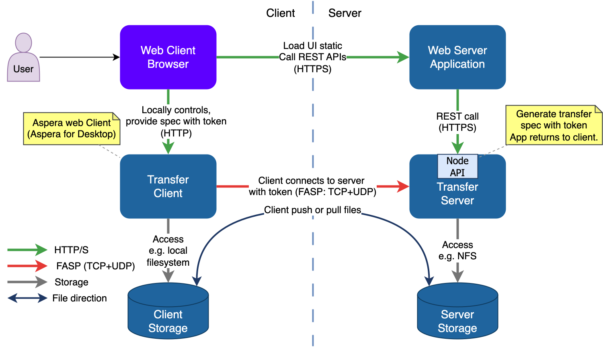

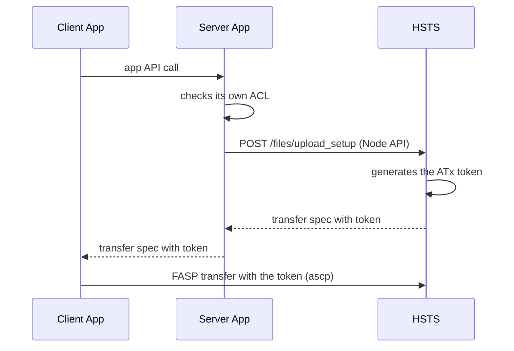

#### Token generation

When user authentication and authorization are managed by a third-party application,
then the application needs to provide the client side with a secure "token" that will carry the transfer authorization.
The application uses the Node API endpoints:

- `/files/upload_setup`
- `/files/download_setup`
- `/files/sync_setup`

This returns a **transfer spec** that can be directly provided to the transfer agent to do the transfer.
The authorization is based on an authorization token, generated by the node daemon.

Example:

```shell
curl -s -u <HSTS2_NODE_USER>:<HSTS2_NODE_PASSWORD> \
  https://hsts2.example.com:9092/files/download_setup \
  -d '{"transfer_requests":[{"transfer_request":{"paths":[{"source":"/aspera/aspera-test-dir-large/1GB"}]}}]}'
```

```json
{ "transfer_specs": [ { "transfer_spec": {
  "paths": [ { "source": "/aspera/aspera-test-dir-large/1GB" } ],
  "source_root": "",
  "destination_root": "",
  "token": "<TOKEN>",
  "direction": "receive",
  "cipher": "aes-128",
  "tags": null,
  "rate_policy_allowed": "fixed",
  "rate_policy": "fair",
  "target_rate_kbps": 100000,
  "min_rate_kbps": 0,
  "remote_host": "hsts2.example.com",
  "remote_user": "xfer",
  "sshfp": "b42dcb718dd3a04c90e160817d40da9af6e8895a",
  "ssh_port": 33001,
  "fasp_port": 33001,
  "http_fallback": true,
  "http_fallback_port": 8443
} } ] }
```

Aspera Transfer tokens start with `AT` and end with `TA`.
They are generated using the **Gen3** Node API (`/files/*_setup`).
They can also be generated using the utility `astokengen`, but this shall be avoided (legacy).

Generation of Aspera Transfer tokens requires the use of a token encryption key (symmetric)
which is either configured statically in `aspera.conf` (`token_encryption_key`) or uses `askms` (dynamic keys).
This type of token is simply binary metadata encrypted (and then decrypted) with that key and includes:

- Transfer direction (send/receive, as seen from the server)
- Transfer user
- Date validity
- Hash of authorized file list

When a transfer is initiated with a server and contains such a token,
that server checks that each of these elements is valid, otherwise the transfer is refused.
This means that in order to be authorized to transfer with a transfer server using such token,
the token (and transfer spec) must be generated on that same server (or cluster) using the Node API.
The validity period is specified in `aspera.conf` (`token_life_seconds`): 1 day by default.

### A3- Aspera Bearer Token Authorization

This is the more advanced pattern,
used when access control should be managed **directly inside the HSTS** rather than in a broker application.
It is required for **Aspera on Cloud (AoC)** integration and any integration using the Gen4 file ID API.

Key characteristics:

- An application (Aspera or custom web app) authenticates users
  and grants access to its OAuth API in web or API context (possibly with an external auth system, like SSO).
- Files are addressed by **file ID**, not by path.
  The client must first resolve paths to IDs via `GET /files/{id}/files` before transferring.
- **Permissions are set in advance** on the HSTS using `POST /permissions`,
  associating user identifiers (and optional group identifiers) with specific file IDs and access levels.
- The application generates a **JWT Bearer token** signed with its private key, and provides it to the client.
  The HSTS validates it using the corresponding public key, configured in advance in the access key.
  The Bearer token contains the user identifier and group memberships.
- A single token can be generated **once** and reused for its entire validity period
  — the client does not need to call the Node API per transfer.

When a transfer starts, the HSTS checks that the resource (folder/file) is granted access
to the user and group IDs found in the bearer token.

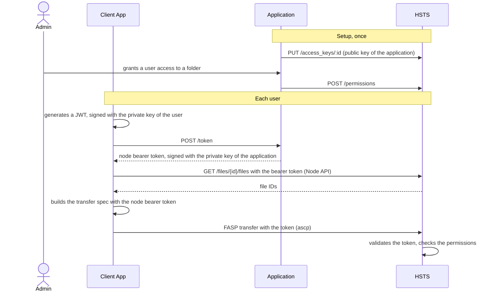

The added complexity is the trade-off for eliminating the broker intermediary and gaining a richer,
ID-stable permission model suitable for multi-tenant or cloud storage environments.

#### A3: Scenario

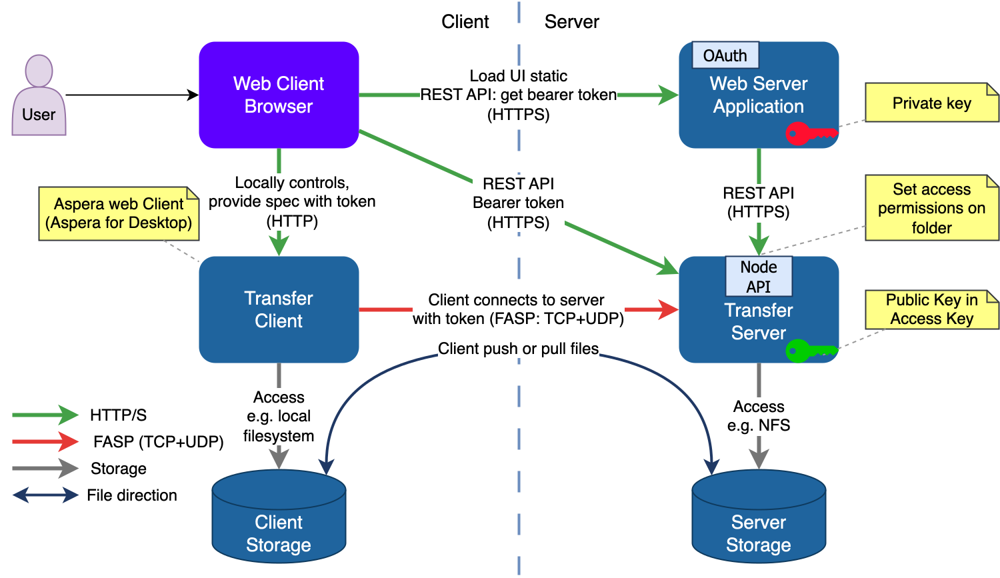

1. The user gets a transfer bearer token for a specific HSTS after authentication to the app.
2. The user uses that bearer token to start transfers. There is no need to re-generate a token for each transfer.
3. The user can also use the bearer token to list files on HSTS directly.
4. Permissions to access files on HSTS are managed out of band, beforehand.

There is no API to generate a full transfer spec directly,
but one can use the Gen3 API to generate a base transfer spec on the HSTS,
and then change the token in it with the bearer token.

An example of how to configure and generate a bearer token is provided in the `ascli` manual.

The scenario to prepare is:

1. Prepare an Aspera HSTS for use with access keys, and create an access key, for example using the API or `ascli`:
   <https://github.com/IBM/aspera-cli/blob/main/docs/README.md#creating-an-access-key>
2. Follow:
   <https://github.com/IBM/aspera-cli/blob/main/docs/README.md#generating-and-using-a-bearer-token>

## Aspera applications

For integration with IBM Aspera applications, use their embedded authentication/authorization and APIs:
these, in turn, provide the transfer spec (with token) necessary to initiate a transfer.

For more details, refer to [Aspera API Hub].

The general flow is the same as seen earlier with the custom client and server.

Aspera Web Apps provide REST APIs.
Some are related to transfer authorization, and others are not directly (e.g. list files, create a user, etc.).

### Pattern for all applications

Whatever the application, a transfer follows the same three steps:

1. **Authenticate** to the REST API of the application (OAuth 2.0 bearer token).
2. **Get a transfer spec** with a token from the application (Faspex), or build it (AoC),
   after creating or selecting the resource to send to or receive from (package, shared inbox, folder).
3. **Start the transfer** with a transfer agent (Transfer Daemon or Web SDK), using that transfer spec,
   adding only the local files.

The application authorizes the transfer: do not try to reach the transfer server directly with other credentials.

### Faspex

In this guide, Faspex is IBM Aspera Faspex 5, the only supported version (Faspex 4 is deprecated).

API reference: [Faspex OpenAPI](../openapi/IBM%20Aspera%20Faspex%20API-5.0-enhanced.yaml)
(see [API definitions](#api-definitions)).

The sample `faspex5` implements the whole sequence.
Implementations (same steps and same log messages in each language):

| Language | Sample |
|---|---|
| Python | [faspex5.py](../app/python/src/examples/faspex5.py) |
| JS | [faspex5.js](../app/js/src/examples/faspex5.js) |
| Go | [faspex5.go](../app/go/src/examples/faspex5.go) |
| Java | [Faspex5Send.java](../app/java/src/main/java/examples/Faspex5Send.java) |
| Ruby | [faspex5.rb](../app/ruby/src/examples/faspex5.rb) |
| Rust | [faspex5.rs](../app/rust/src/examples/faspex5.rs) |
| C++ | [faspex5.cpp](../app/cpp/src/examples/faspex5.cpp) |
| C# | [faspex5.cs](../app/csharp/src/Examples/faspex5.cs) |

Sending local files in a package, step by step (base URL: `https://<FASPEX5_HOST>/aspera/faspex`):

| Step | Call | Result |
|---|---|---|
| 1. Get a bearer token | `POST /auth/token` with a JWT assertion | Bearer token (re-use until it expires) |
| 2. Find the recipients | `GET /api/v5/contacts?q=<EMAIL>&context=packages` | Recipient name and type; unknown email: `external_user` |
| 3. Create the package | `POST /api/v5/packages` with `title` and `recipients` | Package `id`: this allocates the reception folder |
| 4. Get the transfer spec | `POST /api/v5/packages/{id}/transfer_spec/upload?transfer_type=connect` | Transfer spec with token |
| 5. Prepare the transfer spec | Add `paths` (local files), delete the `authentication` key | Transfer spec for the Transfer Daemon |
| 6. Start the transfer | Transfer Daemon `StartTransferWithMonitor` (or Web SDK `startTransfer`) | Upload to the package folder |

The calls between the components:

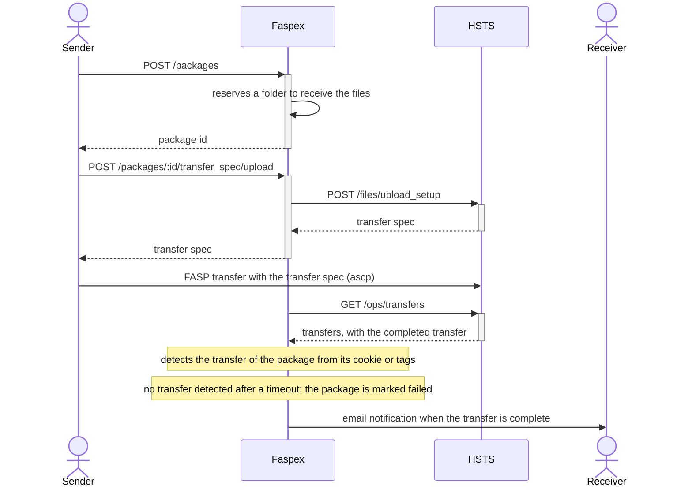

Faspex follows the transfers on the HSTS with `GET /ops/transfers` (Node API).
It recognizes the transfer of a package by the transfer cookie or tags.
If no transfer is detected after a timeout, the package is marked failed.
When the transfer is complete, Faspex sends an email notification to the recipient.

To receive a package, step 4 becomes `POST /api/v5/packages/{id}/transfer_spec/download?transfer_type=connect&type=received`,
and the direction of the transfer spec is `receive`.
List the packages to receive with `GET /api/v5/packages`.

Step 6 can use any transfer agent: Transfer Daemon, Web SDK, or the Node API of a server.

To send files that are already on a Faspex shared folder (server-side, no local file):
after step 3, `POST /api/v5/packages/{id}/remote_transfer` with `shared_folder_id` and `paths`,
then poll `GET /api/v5/packages/{id}/upload_details` until `upload_status` is `completed` (or `failed`).
No transfer agent is needed: the Faspex server does the transfer.

Points to remember:

- `transfer_type=connect` gives a transfer spec that works with the Transfer Daemon and the Web SDK.
  Use `http_gateway` only for a client that must use the HTTP Gateway.
- The transfer spec has an `authentication` key that the Transfer Daemon does not use: the samples remove it.
- Check the permissions of the calling user: sending to external users or to some recipient types may be refused.

#### Authentication

Faspex uses OAuth 2.0 for authentication and authorization: each REST API call carries a bearer token.
For automated operations, the application gets the bearer token with a JWT (JSON Web Token) signed with a private key:

1. Once: get a client ID and a client secret from Faspex, in the web interface, section "API Clients".
2. Once: the user generates a private/public key pair.
   The public key is configured in Faspex, in the user's profile or in the API client configuration.
3. The application builds a JWT with the claims below,
   and signs it with RS256, with the private key of the user.
4. The application calls `POST /auth/token`, with the form parameters `grant_type`
   (`urn:ietf:params:oauth:grant-type:jwt-bearer`), `client_id` and `assertion` (the signed JWT),
   and the client ID and client secret of the API client as HTTP Basic authentication.
5. The response contains `access_token`: the bearer token for the Faspex REST API, re-used until it expires.

The claims of the JWT:

| Claim | Value |
|---|---|
| `iss` | The client ID of the API client |
| `aud` | The client ID of the API client |
| `sub` | `user:<USERNAME>` |
| `iat`, `nbf`, `exp` | Dates, with a short validity |
| `jti` | A unique identifier |

The `faspex5` sample implements these steps.
For details, refer to the [Faspex documentation](https://www.ibm.com/docs/en/aspera-faspex/5.0).

### IBM Aspera on Cloud

Similar to Faspex, AoC uses OAuth 2.0 for authentication and authorization:
an API client (client ID and secret), and `POST /oauth2/<ORG>/token` with a JWT signed with the private key of the user.

There is no endpoint to create a transfer spec directly,
but a transfer spec can be built relatively easily: refer to the `aoc` sample.

API reference: [AoC OpenAPI](../openapi/IBM%20Aspera%20on%20Cloud%20API-0.2.6-enhanced.yaml)
(see [API definitions](#api-definitions)).

AoC uses two levels of bearer tokens (see [A3](#a3--aspera-bearer-token-authorization)):

- a token for the AoC API (scope `user:all`),
- a token for the transfer server (node) that holds the files (scope `node.<ACCESS_KEY>:user:all`),
  in the `token` of the transfer spec.

Both are obtained the same way: JWT signed with the private key of the user, sent to the same token endpoint.
This JWT flow is for any application that needs a browser-less authentication, such as `ascli`.

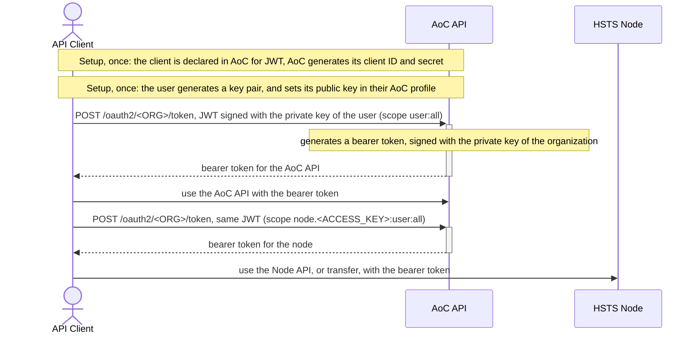

Other OAuth grant types of AoC:

- The basic grant type `password` (username and password) works only for local users, not for Google or SAML users.
- The grant type `code` works for any user (local users, Google, SAML): it is an interactive login, in a browser.

With `grant_type=code`, the client is registered in AoC with a `redirect_uri`,
and AoC generates its client ID and secret.
The client listens on the `redirect_uri` (a local TCP port), and opens a browser on the login address:

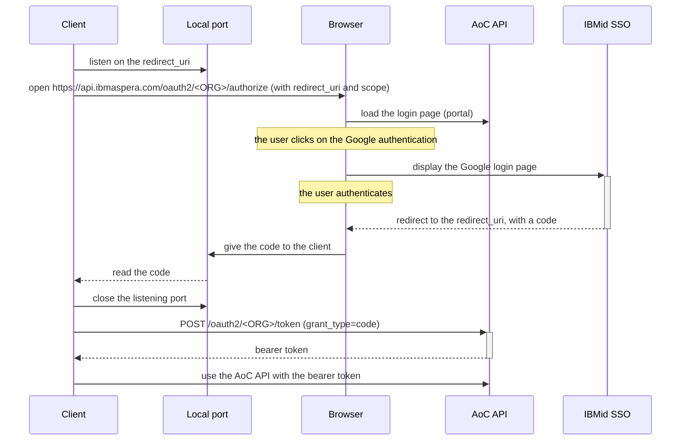

Implementations (same steps and same log messages in each language):

| Language | Sample |
|---|---|
| Python | [aoc.py](../app/python/src/examples/aoc.py) |
| JS | [aoc.js](../app/js/src/examples/aoc.js) |
| Java | [Aoc.java](../app/java/src/main/java/examples/Aoc.java) |
| Ruby | [aoc.rb](../app/ruby/src/examples/aoc.rb) |
| Rust | [aoc.rs](../app/rust/src/examples/aoc.rs) |
| C++ | [aoc.cpp](../app/cpp/src/examples/aoc.cpp) |
| C# | [aoc.cs](../app/csharp/src/Examples/aoc.cs) |

Sending local files to a shared inbox, step by step (base URL: `https://api.ibmaspera.com/api/v1`):

| Step | Call | Result |
|---|---|---|
| 1. Get an API token | `POST /oauth2/<ORG>/token`, JWT assertion, scope `user:all` | Bearer token for the AoC API |
| 2. Get the user | `GET /self` | User name and email (for the cookie) |
| 3. Find the workspace | `GET /workspaces?q=<NAME>` | Workspace `id` |
| 4. Find the shared inbox | `GET /dropboxes?current_workspace_id=<ID>&q=<NAME>` | Shared inbox `id` |
| 5. Create the package | `POST /packages` with `workspace_id`, `recipients` (type `dropbox`), `name`, `sent`, `transfers_expected` | Package `id`, `node_id`, `contents_file_id` |
| 6. Get the node | `GET /nodes/{node_id}` | Node `host` and `access_key` |
| 7. Get a node token | Same token request, scope `node.<ACCESS_KEY>:user:all` | Bearer token for the node |
| 8. Build the transfer spec | See below | Transfer spec |
| 9. Start the transfer | Transfer Daemon `StartTransferWithMonitor` (or Web SDK `startTransfer`) | Upload to the package folder |

The transfer spec of step 8 contains:

| Parameter | Value |
|---|---|
| `direction` | `send` |
| `token` | The node token of step 7 |
| `remote_host` | `host` of the node |
| `remote_user`, `ssh_port`, `fasp_port` | `xfer`, `33001`, `33001` |
| `cookie` | `aspera.aoc:<APP>:<USER_NAME>:<USER_EMAIL>`, each of the three values in base64 (`APP` is `packages`) |
| `tags.aspera.app` | `packages` |
| `tags.aspera.node` | `access_key` of the node, `file_id`: `contents_file_id` of the package |
| `tags.aspera.files` | `node_id`, `package_id`, `package_name`, `package_operation`: `upload`, `files_transfer_action`: `upload_package`, `workspace_id`, `workspace_name` |
| `paths` | The local files |

The `tags` are mandatory: `node` tells the transfer server which access key and folder the token authorizes,
and `app` and `files` let AoC link the transfer to the package.
`usage_id` and `xfer_retry` are optional.

Points to remember:

- The `aud` claim of the JWT is specific to AoC (see the sample), and `sub` is the email of the user.
- The sample creates the package with `sent: true` and `transfers_expected` (number of transfer sessions).
  These two parameters can also be set later with `PUT /packages/{id}`.
- The sample generates new tokens at each run: in real code, re-use the token until it expires.

### IBM Aspera Shares

Same API as Node API (internally, Shares calls the Node API for transfer spec generation).
API reference: [Shares OpenAPI](../openapi/IBM_Aspera_Shares.yaml) (admin APIs),
and the [Node API](#node-api) for transfers (see [API definitions](#api-definitions)).

## Node API

The **IBM Aspera Node API** is a REST API (JSON over HTTP or HTTPS)
that runs on an Aspera transfer server, called a *node*.
It is part of IBM Aspera High-Speed Transfer Server and Endpoint, as a daemon.
It provides:

- file operations on the storage of the node: browse, create, delete, rename, search
  (see [File endpoints: Gen3 and Gen4](#file-endpoints-gen3-and-gen4)),
- transfer authorization: a transfer spec with a token (see [A2](#a2--aspera-transfer-token-authorization)),
- transfers started by the node, with FASP or HTTP fallback: start, stop, resume, reconfigure and monitor
  (see [S4](#s4--start-a-server-server-transfer-with-node-api-and-ssh-credentials),
  [S6](#s6--start-a-server-server-transfer-with-node-api-and-transfer-token)
  and [S7](#s7--polling-on-transfer-status-on-node-api)),
- access management: access keys, and permissions for bearer tokens,
- monitoring: node information, available space (HSTS only),
  events (transfer start, file creation, permission changes), bandwidth and transfer volume.

`GET /ping` checks that the node responds.
`GET /info` returns the configuration of the node.
Read it first: some nodes require specific key-value pairs in requests.

API reference: [Node API OpenAPI](../openapi/IBM%20Aspera%20Node%20API-4.4.6.yaml)
(see [API definitions](#api-definitions)): endpoints, parameters, request and response bodies (JSON), and status codes.

### Supported Node Types

The Node API is available on several types of Aspera servers:

| Node Type | Description |
|---|---|
| **IBM Aspera High-Speed Transfer Server (HSTS)** | Self-managed Aspera transfer server |
| **IBM Aspera High-Speed Transfer Endpoint (HSTE)** | Self-managed limited version of HSTS |
| **Aspera on Cloud (AoC) Transfer Service (ATS)** | Aspera's cloud-based SaaS hosted service<br/>(IBM-managed HSTS clusters) |

### Network Interface & Port Configuration

The Node API daemon listens on both HTTP and HTTPS interfaces:

| Protocol | Default Port | Default Activation |
|---|---|---|
| **HTTPS** | `9092` | Yes |
| **HTTP** | `9091` | No |

> [!NOTE]
> Port numbers and activation are configurable through `aspera.conf`.
> If facing the Internet, it is recommended to place a reverse proxy, such as `nginx`, in front of the Node API.

### Authentication

The Node API accepts:

- HTTP Basic authentication (username and password) with a **node user** or an **access key** (ID and secret),
- an OAuth 2.0 **bearer token**, always associated with an access key.

#### Node Users

Node users are managed with the `asnodeadmin` utility:

```shell
# create a node user
asnodeadmin -a -u <NODE_USER> -p <NODE_PASSWORD> -x <TRANSFER_USER>
# list the node users
asnodeadmin -l
```

A node user is always associated with a **transfer user**: an OS user.
Transfers started or authorized with the Node API run as this OS user.
The file system access rights of this user apply (not applicable to object storage).

The configuration of the transfer user gives the type of the node user:
either a docroot, or file restrictions (exclusive).
It is in `aspera.conf`, modified with `asconfigurator`.
Refer to the HSTS manual section: "Docroot vs. File Restriction".
In both cases, Node API calls and transfers are "jailed",
either in the docroot, or in the storage root of the access key.

| Node user type | Transfer user has | Used for | Not for |
|---|---|---|---|
| **Transfer node user** | A **docroot** (`absolute`) | Managing transfers directly | Creating access keys |
| **Master node user** | No docroot, but **file restrictions** (can be open, like `*`) | Creating access keys | Transfers |

The docroot is a PVCL URL, which can range from a local file system to object storage (e.g. S3).
There is usually a single master node user, but there can be more if distinct restrictions are needed.
The master node user is usually associated with the transfer (OS) user `xfer`, but it is not mandatory.

> [!CAUTION]
> A transfer node user cannot be used to integrate with **Aspera on Cloud**, which requires access keys.
> If access keys created with a master node user are to be used with Aspera on Cloud, or Aspera Enterprise Web Apps,
> then it is mandatory to name the transfer user `xfer`.

#### Access Keys

An access key is created and managed through the Node API, and has a **storage root**.
AoC provides an API (ATS) to create access keys on SaaS nodes.

- A **primary access key** is created with a master node user.
  Its storage root is a JSON in the `storage` key of the access key,
  and must comply with the file restrictions of the master node user.
  The storage `type` can be `local` (local file system), or object storage (e.g. S3).
- A **sub access key** is created with a primary access key.
  Its storage `type` is `local`, and its `path` is relative to the storage root of the primary access key.
  The `path` cannot be `/`: it must be a sub-folder within the storage root of the primary access key.

#### OAuth2 Bearer Tokens

Bearer tokens are used for integration with cloud services like **Aspera on Cloud (AoC)**.
A bearer token is always associated with an access key, and requires the Gen4 `/files/{id}` endpoints.
It contains a user identifier, managed by the application above the node, and optional group identifiers.

Access to file resources is granted on the access key with the `/permissions` endpoint,
with user and group identifiers, and access levels.
See [A3](#a3--aspera-bearer-token-authorization), and a sample scenario in the `ascli` manual.

### File endpoints: Gen3 and Gen4

The Node API has two groups of endpoints to manage files:

- **Gen4**, `/files/{id}`: files are managed by their **file ID**.
  For example, `GET /files/{id}/files` lists a folder.
  This is the group recommended by Aspera.
- **Gen3**, `/files/*`: files are managed by their **path**.
  For example, `POST /files/browse` lists a folder.
  This is the earlier group (legacy, still supported).

File IDs are managed by the node daemon,
and are stored in a Redis database of HSTS together with the permissions.

| | Gen4 `/files/{id}` | Gen3 `/files/*` |
|---|---|---|
| Files addressed by | ID: operations are more robust | Path |
| Credentials | Access key (ID and secret, or bearer token) | Node user or access key |
| Bearer token | Supported (required for AoC integration) | Not supported |
| Search and browse | More powerful glob filtering | `/files/browse` and `/files/search` can be very slow on cloud storage |

> [!IMPORTANT]
> Gen4 is strongly recommended for cloud-based nodes, due to significantly better performance.
> For cloud-based nodes, always prefer `/files/{id}/files` over `/files/browse`.

### Error Handling

When a request fails, the server returns a structured JSON error object:

```json
{
  "error": {
    "code": 404,
    "reason": "Not Found",
    "user_message": "Transfer activity logging disabled"
  }
}
```

- Always check the returned JSON for an `error` field when the HTTP status code is not `2xx`.
- Some known errors may cause the API to return an **empty JSON object** `{}` instead of an error body
  — your client code should handle this case explicitly.
- Do not rely solely on the HTTP status code for error detection.

```javascript
// Example: defensive error checking in JavaScript
// (the body is empty for 204 No Content)
const text = await response.text();
const data = text ? JSON.parse(text) : {};
if (!response.ok || data.error || (response.status !== 204 && Object.keys(data).length === 0)) {
  throw new Error(data?.error?.user_message ?? `Unknown error from Node API: HTTP ${response.status}`);
}
```

## Troubleshooting

### Find where the problem is

A transfer involves three steps, and each one fails in its own way:

1. **Get authorization**: REST calls to an application or to the Node API.
   Failure: HTTP error, or an error JSON. No transfer has started yet.
2. **Start the session**: the client `ascp` connects to the server (SSH or WSS, TCP).
   Failure: authentication or authorization error, the session stops at once.
3. **Move the data**: UDP between the two `ascp`.
   Failure: the session starts, but no data moves, or the rate is very low.

Increase the log level, in this order:

| What | How |
|---|---|
| REST calls of the samples | `misc.level: debug` in the configuration file: shows each request and response (secrets are masked, unless `misc.show_secrets: true`) |
| Transfer spec | Same: displayed at `debug` level |
| `transferd` | `trsdk.level: debug`, and the `.out` and `.err` files of the daemon |
| `ascp` | `trsdk.ascp_level: debug` (or `trace`), or `ascp -DDL-` on the command line |
| The same transfer spec, outside of your code | `ascli`, for example `ascli -N server --url=ssh://hsts1.example.com:33001 ...` (see [S1](#s1--the-simplest-integration-start-a-transfer-with-a-script-and-ascp)) |

If a transfer works with `ascp` or `ascli` and not in your code, compare the two transfer specs.

### Common problems

| Symptom | Likely cause | What to do |
|---|---|---|
| `transferd` or `ascp` does not start, or reports a license problem | `ascp` has no license file | Check `ascp -A`: the `aspera-license` file must be in the same folder as `ascp`, or in `../etc` (see [Client-side minimum components](#client-side-minimum-components)) |
| The session starts, then no data moves, or it ends on a timeout | The UDP port (`fasp_port`, `33001` by default) is blocked by a firewall | Open UDP in both directions between client and server. The TCP port (`ssh_port`) works, so authentication succeeds: the problem is only on UDP |
| Authentication error with a token | Wrong token type for the API, token generated for another access key or node, or expired token | See [Choosing the Right Token Type](#choosing-the-right-token-type). Do not mix a token of one type with the file addressing of another (path for ATx, file ID for bearer) |
| Authentication error with a token, while SSH works | The transfer user does not accept token authentication over SSH | Enable Aspera SSH public key authentication for the transfer user (see [Transfer authentication and authorization](#transfer-authentication-and-authorization)) |
| HTTP Gateway or WebSocket session refused | These need a token: SSH credentials do not work | Use token authorization (see [A1](#a1--ssh-authentication)) |
| The transfer starts then fails with a permission or access error | The destination is outside the docroot or storage root, the user cannot write there, or (bearer token) no permission was granted on the folder | Check the docroot or access key, the transfer user, and `POST /permissions` for the bearer token (see [A3](#a3--aspera-bearer-token-authorization)) |
| `401` from `/auth/token` of Faspex | API client not set up, public key not configured for the user, or wrong `sub` | Check the client ID and secret, and that `sub` is `user:<USERNAME>` (see [Faspex](#faspex)) |
| `401` from the token endpoint of AoC | Wrong `org`, `aud` or `sub`, or public key not set in the AoC user profile | Check the values with the `aoc` sample (see [Aspera on Cloud](#ibm-aspera-on-cloud)) |
| The transfer works, but the package does not show the files (AoC) | Missing `tags`, or wrong `package_id` or `node_id` in them | Rebuild the transfer spec as in the `aoc` sample |
| Faspex transfer spec refused by the Transfer Daemon | The `authentication` key was left in the transfer spec | Remove it, as the samples do |
| Node API returns `{}` or an unexpected empty body | Some known errors have no error body | Treat an empty JSON as an error (see [Error Handling](#error-handling)) |
| Certificate error calling an HTTPS API | Self-signed certificate on a test server | In the samples, set `verify: false` for this server in the configuration file. In production, install the CA certificate: do not disable verification |
| A rate lower than expected | The license, `aspera.conf` or the transfer spec (`target_rate_kbps`) limit the rate, or the network is the limit | Check the license limit with `ascp -A`, then the rate parameters of the transfer spec and the server |

### Before asking for help

Collect:

- the versions: `ascp -A` (shows `transferd` and `ascp`), and the server version,
- the transfer spec, **without secrets and tokens**,
- the `ascp` log at `debug` level (`ascp_level`),
- which step fails: authorization, session start, or data transfer.

[HSTS Doc]: https://www.ibm.com/docs/en/ahts
[Transfer Daemon SDK]: https://developer.ibm.com/apis/catalog?search=%22aspera%20transfer%20sdk%22
[Aspera API Hub]: https://developer.ibm.com/apis/catalog?search=aspera
