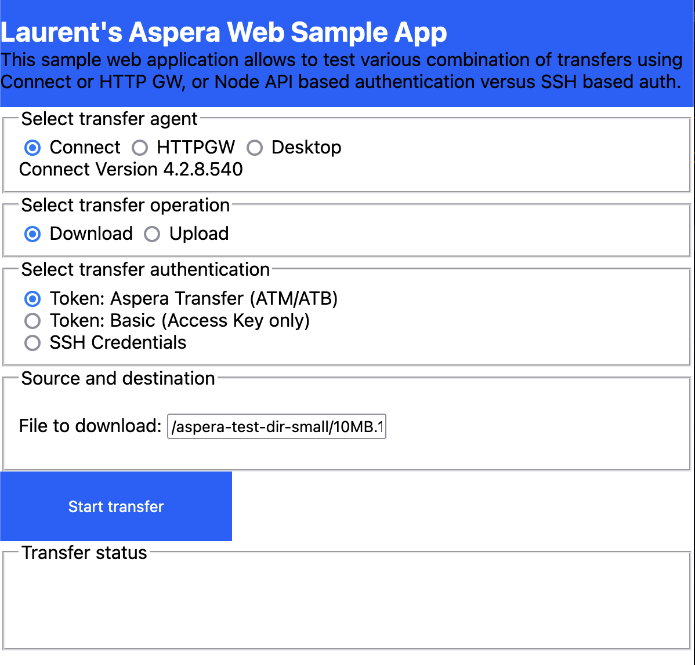
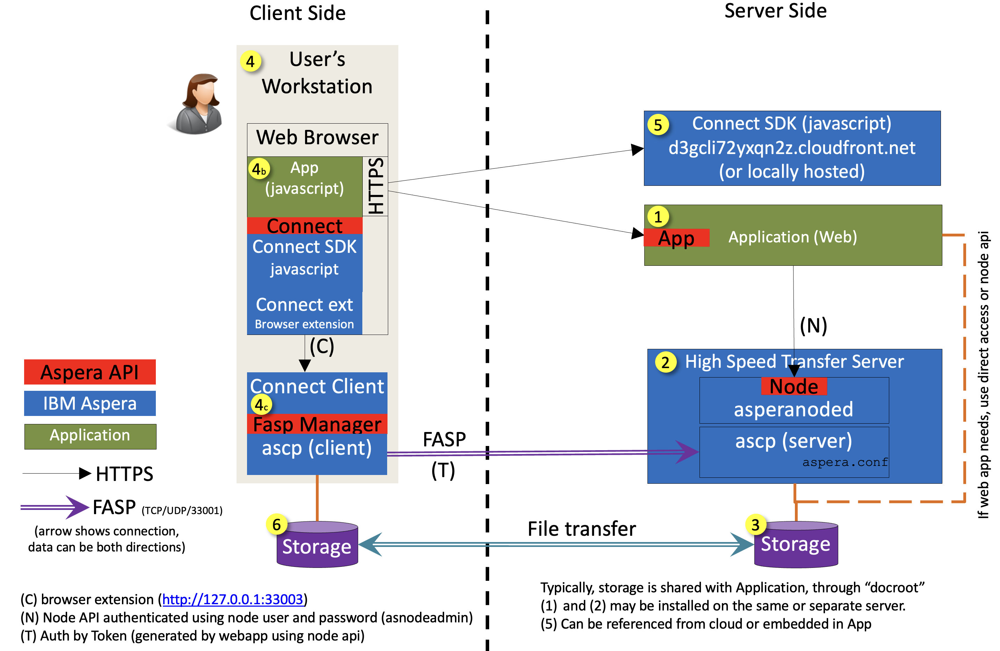
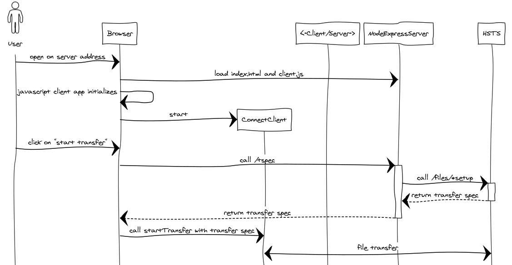

# Aspera transfers in Web Applications

## References

The current SDK for web app development is located at:

[web SDK repo](https://github.com/IBM/aspera-sdk-js)

[web SDK running example](https://ibm.github.io/aspera-sdk-js)

[web SDK TypeDoc documentation](https://ibm.github.io/aspera-sdk-js/docs/)

[Migration guide from the former SDKs](https://github.com/IBM/aspera-sdk-js/blob/main/MIGRATION.md)

[All Aspera APIs here](https://developer.ibm.com/apis/catalog?search=aspera)

## This repo

This sample application shows how to build an Aspera-transfer-enabled web application using the unified Aspera web SDK.



Starting a transfer consists of building a **transfer spec**
and then calling the browser-side JavaScript `startTransfer` API.

The transfer spec is Aspera's structure that contains all information to start a transfer:

- The HSTS server address, TCP method (SSH or HTTPS), TCP and UDP ports.
- Authorization (token, SSH key or password, etc.)
- Transfer direction, source files and destination folder
- Optional parameters such as resume policy, target rate, etc.

An Aspera transfer is authorized either:

- using a token (use this in web apps)
- using SSH credentials (mostly legacy or server-server transfers)

> [!NOTE]
> The SSH-based transfer authorization is not recommended for web applications,
> as users shall be authorized through the web app.
> The legacy Aspera "Connect Server" web app used SSH authentication, but is deprecated.

Web applications shall use the "token" authorization scheme, with one of these types:

- Aspera Transfer token (a string that starts with either `ATM` or `ATB` and ends with the same letters reversed)
- OAuth 2.0 bearer token (a string that begins with `Bearer`)
- Basic token (a string that begins with `Basic`, mainly for testing purposes, available only with access keys)

In this example, the transfer spec is built either:

- Using a broker app (server) which in turn calls the HSTS node API
  - it generates an Aspera Transfer token: this is the recommended way, or
  - it uses a Basic token (for testing purposes only, do not use this in web apps):
    the user types the access key and its secret in the page.
- Using SSH credentials (do not do that: for testing purposes only): in that case, the HSTS Node API is not used,
  but the SSH user's credentials must be known, and that transfer user must be authorized on the HSTS server without a token.
  The user types the SSH password in the page.
  For example, this is not possible on AoC/ATS SaaS Aspera transfer servers.



The web application is split into two parts:

- [`src/client/client.ts`](src/client/client.ts) runs in the browser, loaded by the main application page [`index.html`](index.html)
- [`src/server/server.ts`](src/server/server.ts) runs in Node.js and is called by the client. It calls the Node API of HSTS.



## Read this first

The whole transfer flow, in the order it happens
(function names are in [`client.ts`](src/client/client.ts) unless noted):

1. **Load config**: the page fetches `/api/config` from the server (the few values it needs, no secret),
   then `ClientApp.initialize()` runs.
2. **Initialize the SDK**: `reinitSdk()` calls `initSession()` with the settings of the selected transfer agent
   (Desktop, Connect or HTTP Gateway), after registering `registerStatusCallback()` and `registerActivityCallback()`.
3. **Wait for status `RUNNING`**: `handleStatusEvents()` receives SDK status changes.
   Once `RUNNING`, it enables drag and drop with `initDragDrop()` and `createDropzone()`
   (not for HTTP Gateway, where only the file dialog is used).
4. **Choose what to transfer**: `pickFiles()` uses `showSelectFileDialog()` or `showSelectFolderDialog()`,
   or the user drops files in the drop area.
5. **Get a transfer spec**: `startClientTransfer()` builds it with `getTransferSpecFromServer()`,
   which calls `POST /api/tspec`.
   The server ([`server.ts`](src/server/server.ts)) calls the HSTS Node API `files/<operation>_setup`
   and returns the transfer spec.
   Before that call, a real broker checks that the authenticated user may transfer these files
   (step 3 of [A2](../guide/README.md#a2--aspera-transfer-token-authorization)):
   this demo has no user, and a comment in `/api/tspec` marks the place.
   (With SSH credentials, `getTransferSpecSSH()` builds the spec in the browser instead.)
6. **Start the transfer**: `startClientTransfer()` calls `startTransfer(spec, settings)`.
   The second argument holds IBM Aspera settings that are not part of the transfer spec,
   such as `allow_dialogs` (Desktop only: bring the app to the front or keep it hidden),
   set by the switch on the page.
7. **Follow progress**: `handleTransferEvents()` receives transfer events from `registerActivityCallback()`
   and updates the list of transfers. Existing transfers are loaded with `getAllTransfers()` once the SDK is `RUNNING`.
8. **Control transfers**: `controlTransfer()` calls `stopTransfer()`, `resumeTransfer()` or `removeTransfer()`
   from the buttons of the transfer list.

The parts that are specific to the Aspera SDK are steps 2, 3, 4, 6, 7 and 8, plus the `/api/tspec` call in step 5.
Everything else (the `uiState` getter, the visibility matrix, status colors, page reload when switching client)
is demo scaffolding for the HTML form: do not copy it.

## Configuration

Refer to [the configuration section of the upper README.md](../README.md#configuration-file)
to create `private/config.yaml`.

This sample app uses these values from the config file (`private/config.yaml`):

```yaml
web:
  port: 9080
node:
  url: https://node.example.com:9092
  verify: false
  username: <NODE_USER>
  password: <NODE_PASSWORD>
server:
  url: ssh://eudemo.asperademo.com:33001
  username: <SERVER_USER>
  file_download: /aspera-test-dir-small/10MB.1
  folder_upload: /Upload
httpgw:
  url: https://mygw.example.com/aspera/http-gwy
```

The server reads the configuration file, and the browser gets only the values it needs.

- `web` and `node` stay in the server: it calls the Node API with the node credentials.
- `GET /api/config` returns an allow-list of values (`clientConfig` in [`server.ts`](src/server/server.ts)),
  used to pre-fill the form: `httpgw.url`, `server.url`, `server.username`, `server.file_download` and `server.folder_upload`.
- No password, secret or other section of the configuration file goes to the browser.
  `server.password` is not used: in SSH mode, the user types the password.

> [!NOTE]
> Node credentials can be either a node user or an access key.
> As the use of SSH credentials is not recommended,
> you may leave `server.url` and `server.username` empty:
> `server.file_download` and `server.folder_upload` pre-fill the file to download and the upload folder.
> The `httpgw` section can also be ignored if you do not want to use HTTP Gateway.

<!-- separate alerts -->

> [!CAUTION]
> The test modes (Basic token and SSH credentials) put a secret in the browser:
> the user types it, and the transfer spec contains it.
> Do not use them in a real app.
> The API of this demo has no user authentication, and `POST /api/shutdown` stops the server:
> the server and `vite` listen on `127.0.0.1` only, so they are not reachable from the network.

## Environment Setup

The server uses [Node.js](https://nodejs.org/) (20.19+ or 22.12+, required by Vite 8).
Install it.
Check the version with:

```bash
node --version
```

## Execution of server, automated

For an automated run, using `make` and the `Makefile` (refer to it), do:

```bash
make run
```

> [!NOTE]
> The `Makefile` installs the Aspera web SDK library (`@ibm-aspera/sdk`) with `npm install`.

If you do not have `make`, refer to the `Makefile` for the startup procedure:

- Install the Node.js packages:

  ```bash
  npm install
  ```

- Run the `express` web server and `vite`:

  ```bash
  npm run all
  ```

To run only the API server (compiled with `tsc`, without `vite`, so no UI), do:

```bash
make server
```

It listens on `127.0.0.1`, port `web.port` (`9080`), and is also what `make run` starts, next to `vite`.
This is useful to test the broker API alone, for example:

```bash
curl -X POST http://127.0.0.1:9080/api/tspec -H 'Content-Type: application/json' \
  -d '{"operation":"download","sources":["<FILE_PATH>"]}'
```

## Using the application

Once the runtime is started:

- `express` serves the API on `127.0.0.1`, port `9080` (`web.port` in `private/config.yaml`;
  if you change it, also update the `/api` proxy target in `vite.config.ts`)
- `vite` serves the client app and works as a reverse proxy for the server API,
  on `127.0.0.1`, port `5173` (`server.host` and `server.port` in `vite.config.ts`)

Use `vite`'s URL in the browser: <http://localhost:5173>

Select the transfer agent: IBM Aspera for Desktop, IBM Aspera Connect, or HTTP Gateway.
Desktop or Connect must be installed and running on your computer
(for Desktop, the status line offers a launch or download link if not),
and HTTP Gateway requires `httpgw.url` in the configuration.
The client app connects to it and shows its status and version.

Select the direction of the transfer: Download or Upload.

Select the type of authorization.
Typically, the "Aspera Transfer token" type is used.
But the sample app also shows how to use other types of transfer authorization.

For download, provide the path on the server; for upload, select local files and the destination folder.

Then start the transfer.

The transfers are listed on the web page, with their progress.
A running transfer can be stopped, a stopped one can be resumed, and any transfer can be removed from the list.
